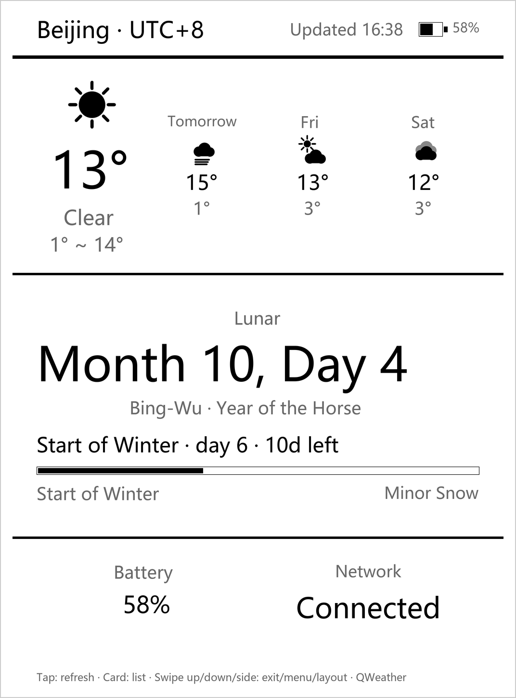
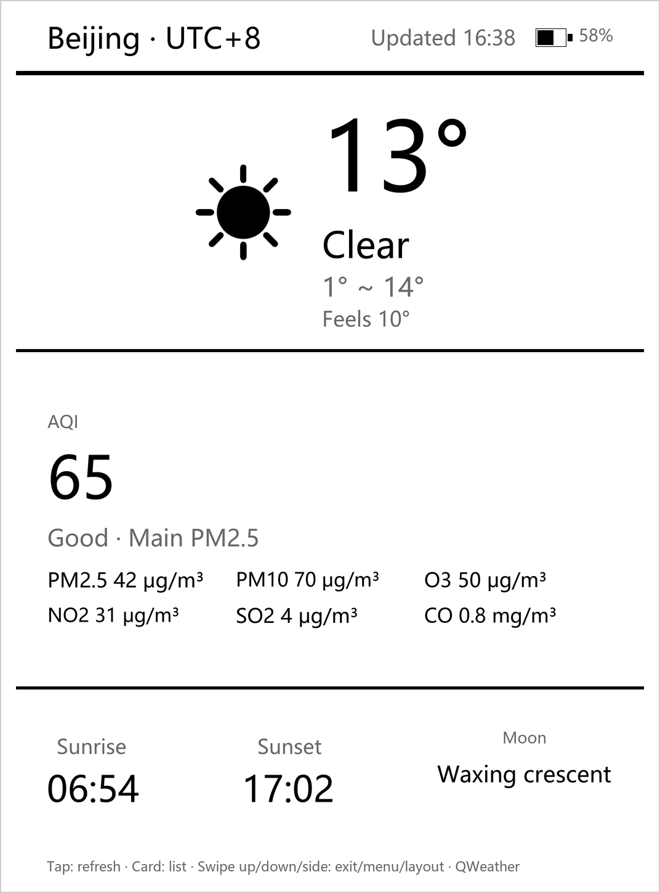
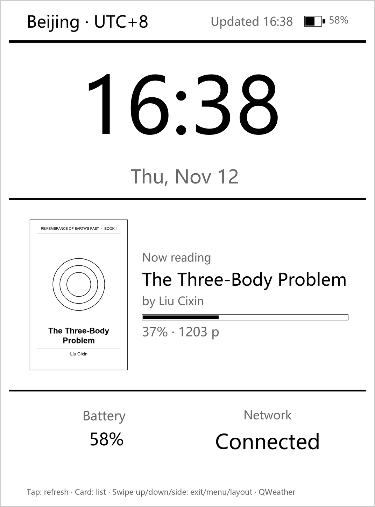
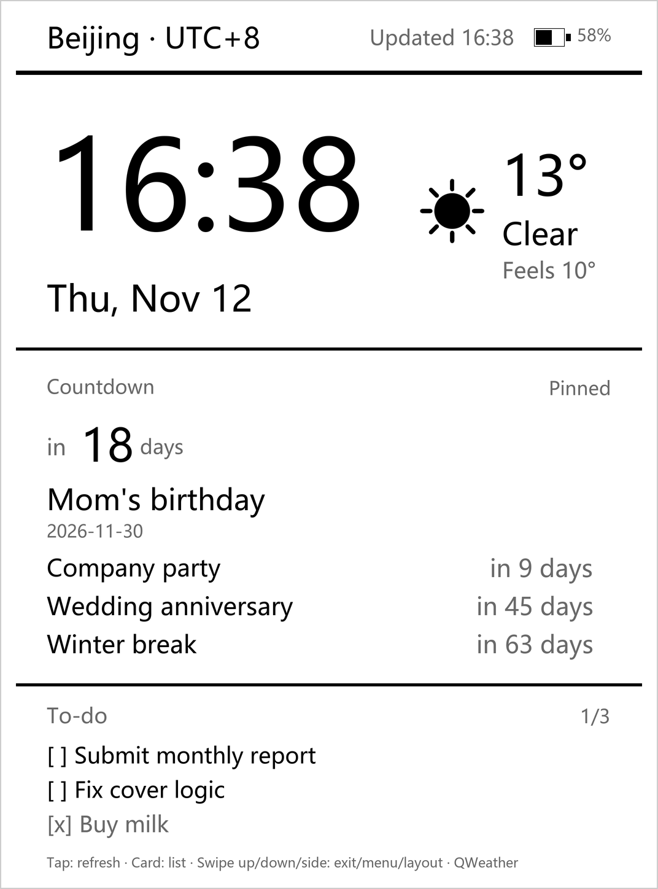
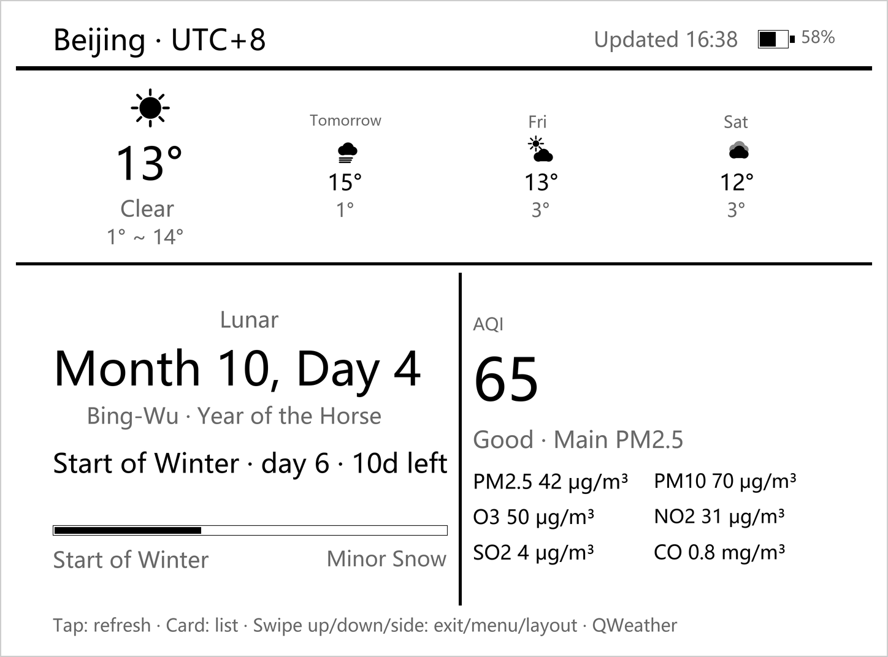
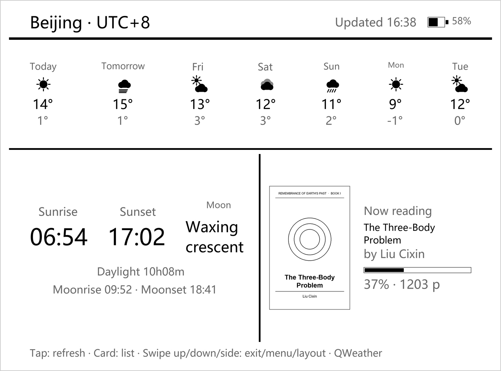
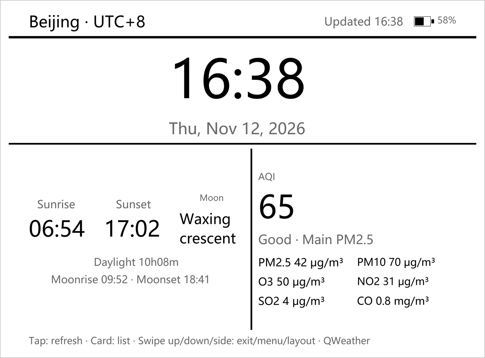
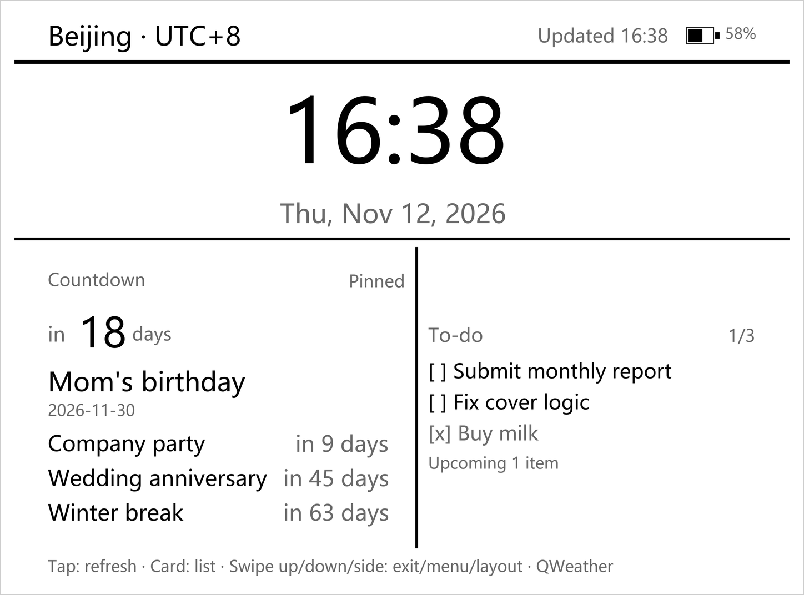

# Kindle Dashboard (KOReader plugin)

[中文](README.md) · **English**

A full-screen always-on dashboard for e-ink Kindles: clock, date and weekday, Chinese lunar
calendar (sexagenary cycle / zodiac), the current solar term with progress, today's weather
(with icons), humidity, wind, air quality (AQI), sunrise and sunset. The layout switches with
screen orientation; cities and time zones are selectable.

## Preview

| Portrait 1072×1448 | Landscape 1448×1072 |
|---|---|
|  |  |

> Rendered by `tools/render_board.py` at exact device pixel size (these are not photos), with
> demo data. The real panel is 300 ppi e-ink: it looks closer to print, has no backlight, and
> its contrast follows ambient light.

The same data with a different mix of widgets is a different board — switch any time from the
menu. The two above are the "classic" layout; the rest below are other combinations (each is a
complete, device-ready layout — 15 widgets can be arranged freely into zones A/B/C per
orientation):

| Portrait · Today & lunar | Portrait · Air & sun/moon | Portrait · Reading | Portrait · Countdown & to-do |
|---|---|---|---|
|  |  |  |  |

| Landscape · Today & air | Landscape · Week & sun/moon | Landscape · Clock & data | Landscape · Clock & to-do |
|---|---|---|---|
|  |  |  |  |

## Two layouts

| Orientation | Layout | Composition |
|---|---|---|
| Portrait (H > W) | Dashboard | City bar / big clock + weather / large lunar line / solar-term progress bar / bottom row of three (humidity · wind · AQI) |
| Landscape (W ≥ H) | Split | City bar / big clock + weather / lower half: full month calendar on the left, lunar and solar term on the right |

- Orientation is decided from `Screen:getWidth()` and `getHeight()`, read once when the board opens.
- **Scale basis: 600 px on the short edge = 1×**. The target device, KPW3, is 1072×1448 (short
  edge 1072 → 1.787×); being 6-inch like 600×800@167ppi, portrait and landscape share the same
  factor, so glyphs keep their physical size when you rotate.
- If the layout does not fit, it steps down 4% at a time (up to 8 passes), so no device ends up
  with a clipped bottom edge.
- **Switching layouts**: swipe left or right once to toggle portrait ↔ landscape. Kindles have no
  accelerometer — turning the device does not change the framebuffer orientation — so switching
  **really rotates the framebuffer** (`Screen:setRotationMode`, the same call behind "rotate
  90°/270°" in the reader); width and height are then swapped and the landscape layout gets a true
  1448×1072 canvas. Exiting the board restores the original orientation. On the rare firmware
  where rotation fails it degrades to "reflow only, no rotation" with a one-line notice. If the
  landscape text comes out upside down, pick "Layout → Landscape (rotate 90° left)".
- The month calendar defaults to landscape zone B: weeks start Monday, leading/trailing days of
  adjacent months are shown in grey, today is reversed, solar-term days carry a dot. Portrait can
  host the calendar in zone B too, with cell size derived from the box width.
- **Cell size and column gaps derive from the box width, not hard-coded**: `7·cell + 6·gap =
  box width`, with the gap at 0.32 of the cell (`CAL_GAP_RATIO`). At 920 wide in portrait that
  gives 7×103 + 6×32 = 913 — the grid fills the content width with clear separation. Landscape
  zone B is only 630 wide, so cells shrink to 92 and the gap goes to 0, i.e. it fills exactly —
  which is why landscape looks unchanged from earlier versions. Cell width also has a 1.62 aspect
  cap (`CAL_ASPECT_MAX`) so wide boxes do not produce flat slivers. At extreme widths such as
  400 px it falls back to `box width / 7`, preferring no gap over overflow.

## Layout zones (since v2.43)

Everything except the city bar and the footer hint is split into **three boxes A / B / C**, each
holding exactly **one** widget, chosen per zone under "Dashboard → Layout widgets"; picking one
replaces the current occupant.

| Orientation | Zone A | Zone B | Zone C |
|---|---|---|---|
| Portrait | 920×407 | 920×505 | 920×232 |
| Landscape | 1276×294 | 630×553 | 593×553 |

- Box heights are fixed and content is centred inside: swapping a widget never shifts the other
  zones or breaks the page box. When a widget is taller than its box the font steps down
  `1 → 0.94 → 0.88 → 0.82 → 0.76` and **nothing is ever clipped**.
- Each zone only accepts a whitelist of widgets (landscape C is 593 wide — a month calendar there
  would touch both edges). An illegal or out-of-zone value in the settings falls back to that
  zone's default.
- "Copy portrait layout to landscape" copies all three zones at once; "Restore default layout"
  deletes the keys so future defaults apply automatically.
- Defaults match v2.42: portrait clock+weather / lunar+solar term / three-cell status, landscape
  clock+weather / calendar / side panel.

### Widget catalogue (15 as of v2.47)

| Widget | Portrait zones | Landscape zones | Notes |
|---|---|---|---|
| Clock + weather | A | A | Default zone A since v2.42 (big clock + weather block on the right) |
| Big clock | A | A | Clock and date only, **no weather** (works without weather data) |
| Big weather | A | A | Large icon + temperature + condition + high/low (portrait adds a "feels like" line) |
| Today + 3 days | A, B | A | Today large on the left, three columns on the right (label/icon/high/low) |
| 7-day forecast | A, B | A, B | Seven rows in portrait, seven columns in a short landscape box |
| Now reading | A, B, C | C | Cover on the left + title / author / progress bar / percent; see "Now reading" below |
| Sun & moon | B, C | B, C | Sunrise / sunset / moon phase in three columns; adds daylight and moonrise/set when the box is tall enough |
| Air quality detail | B | B, C | Large AQI + level·primary pollutant + six concentrations (auto 3/2/1 columns) |
| Battery & network | C | C | Battery percent (with charging note) + Wi-Fi state |
| Countdown | A, B, C | B, C | The pinned event in the large slot, up to three more below; **tap the card to open the list** |
| To-do | A, B, C | B, C | Today's items, completed ones greyed; **tap the card to open the list** |
| Lunar & solar term | B | B, C | The original v2.42 widget |
| Three-cell status | C | C | Humidity / wind / AQI |
| Month calendar | B | B | Full month grid, today reversed, solar-term days dotted |
| Side panel | — | C | Lunar + solar term + sun & air; landscape right column only |

Three arrangement rules (swapping widgets never drags others along):

- **Shrink type, never change width**: when it does not fit, step through
  `1 → 0.94 → 0.88 → 0.82 → 0.76`; only if the smallest step still fails does the whole-screen
  scale-down take over — content is never clipped.
- **Check width too**: the stub's widget matrix asserts both height and width. Adding the width
  check in v2.45 immediately caught the air-quality three-column layout overflowing landscape C
  by 95 px and a status row separated by one pixel too many (323 > 321).
- **Text length follows the language**: English moon phase names (`Waxing crescent`) are more
  than three times as wide as the Chinese ones, so the sun-and-moon columns get explicit widths,
  then a smaller font, then wrapping — never past the box edge.

### Now reading: live document first, lastfile as fallback

Two sources are tried in order; the card renders if either succeeds, and nothing is drawn if both
fail (no empty card is left behind):

1. **Live document**: when `ui.document` exists, read `ui.doc_settings`
   (`stats.title` / `stats.authors` / `percent_finished` / `doc_pages`). Books without
   `percent_finished` (PDFs, some EPUBs) use
   `ui:getCurrentPage() / document:getPageCount()` instead.
2. **lastfile sidecar**: as a screensaver there is no live document, so read
   `G_reader_settings:readSetting("lastfile")` and then `DocSettings:open(path)`. If the sidecar
   does not exist yet (a freshly copied book), fall back to the **file name** — better than
   nothing.

Every field is read inside its own `pcall`: depending on the KOReader version `DocSettings` may be
userdata or a plain table, and an unreadable field is simply treated as absent instead of sinking
the whole card. The title is drawn on a single line with an ellipsis — real titles run 20–30
characters and wrapping would burst the box.

#### Where the cover comes from, and why it is cached

The sidecar only holds text fields (`stats.title` / `authors` / `percent_finished`) — **no
cover**. The cover is a bitmap the rendering engine produces on demand
(`doc:getCoverPageImage()`, which internally calls `loadDocument` and renders page one into a
BlitBuffer); if you never call it, you never get one. That is why early versions showed text only.

The board usually refreshes while **acting as a screensaver**, with no live document — fetching a
cover then means opening the book (crengine load + first-page render, several hundred
milliseconds). So `dashboard_cover.lua` does this:

1. live document → use the in-memory bitmap;
2. otherwise → temporarily `DocumentRegistry:openDocument` that book, grab it, then `close`;
3. scale the bitmap to the card's cover height (width by aspect) and `writePNG` it to
   `settings/dashboard_covers/c_<md5>.png`;
4. every later refresh reads that PNG and **never opens the book again**.

The cache key is an md5 of "book path + file mtime + target height": changing books, re-downloading
one, or resizing the box all invalidate it; at most the 6 most recent files are kept. Any failure
(book unopenable, no cover, unwritable directory) returns `nil`, and then a **same-size hollow
frame with the book's first character** is drawn as a placeholder spine — dropping the cover slot
would change the card width and make the title length jump, and on e-ink a blank patch looks more
like a rendering failure than a frame does.

The cover occupies 90% of the box height at a 2:3 width, capped at 42% of the box width (any wider
and only a few characters of title remain). If the box is too short (< 110 design units) no cover
is drawn at all.

## Countdown & to-do (v2.47)

Both widgets share one data file. Adding and removing happens under "Dashboard → Countdown /
To-dos"; **tapping the card** on the board is read-only (browse and tick off), never destructive.

### Where the data lives

`<KOReader settings dir>/dashboard_agenda.lua` — a plain-text Lua table you can back up or edit by
hand:

```lua
{ seq = 7,
  events = { { id = 1, name = "Mom's birthday", date = "2026-11-30", pinned = true },
             { id = 3, name = "Company party", date = "2026-11-21", pinned = false } },
  todos  = { { id = 2, date = "2026-11-12", text = "Submit report", done = false } } }
```

- Dates are always `YYYY-MM-DD`: human readable, greppable, and stable across time zones.
- It is deliberately not stuffed into `G_reader_settings` — that is KOReader's own settings file,
  and corrupting it breaks the whole reader. A broken separate file only costs you these two
  widgets.
- Finished to-dos are pruned after 30 days (`DONE_KEEP_DAYS`); "Clear completed" is also
  available from the menu.

### Entry takes two steps: name first, then pick the date

> **Why not one line of text**: KOReader on Kindle is a standalone native program and cannot call
> the Kindle system IME (there is no IME interface anywhere in `frontend`, and the PW3 has no
> physical keyboard — only the built-in pinyin virtual keyboard). Since the input method cannot be
> replaced, the input volume is minimised: **type the name once, pick the date, type nothing for
> it**.

| Step | Countdown | To-do |
|---|---|---|
| Step 1 (keyboard) | Event name, e.g. `Mom's birthday` | Task text, e.g. `Submit report` |
| Step 2 (picking) | Year / month / day columns, default today | Same, default today |

- The picker is KOReader's `DateTimeWidget`: arrow buttons page through year/month/day, **no
  keyboard at all**; range 1970–2525.
- A date typed into the name is understood (`Christmas 2026-12-25`): it is extracted as the
  default for step 2 and the name keeps only `Christmas`.
- An empty name is rejected in step 1 ("The name cannot be empty."), step 2 is never reached.
- A countdown requires a date; a to-do without a date is today.
- The first countdown is pinned automatically — otherwise the large slot stays empty and the
  widget looks broken. Pinning is **single-select**: a new pin clears the previous one.
- Old habits still work: `parseEntry` / `parseEvent` / `parseTodo` remain, so `tomorrow / 12-25 /
  2026年12月25日` typed into the name field is still recognised and used to pre-fill the date.

### Display rules

- **Countdown**: the large slot shows the pinned event (`in 18 days` / `today` / `12 days ago`),
  with up to three more in date order below it. A pinned event that has passed stays in the large
  slot (showing "N days ago") rather than disappearing.
- **To-do**: today only, with "done/total" on the right of the title and completed items greyed.
  When today is empty it shows "No to-dos today · 1 item upcoming", so "no data" and "nothing
  today" are distinguishable at a glance.
- The number of rows is not fixed — **it is computed from the box height**: build the header and
  the large slot first, measure their real height, then convert the remainder into rows. Portrait
  zone C (232 px) fits three to-dos; estimating by `k` instead would draw one row too many and
  burst the box.

### Tap to expand

Which card was tapped is decided from **coordinates recorded while painting** (content centring,
page margins and stretched gaps all shift absolute coordinates, so recomputing them would be
off). A hit on the countdown or to-do card opens its list menu (toggle the pin, tick items off,
go add something); a tap anywhere else returns `false` so "tap to refresh weather" still works.

### Why the day math is done by hand

`os.time` differences are unreliable on Kindle: time-zone settings and DST switches break the
86400 constant, while "how many days until December 25" is purely a calendar question. This uses
Howard Hinnant's civil-days algorithm (year/month/day to a continuous day number): integers only,
no time zone, no DST, with assertions covering leap years and century years (1900 is not one,
2000 is).

## Language (中文 / English)

- Menu "Dashboard → Language": follow KOReader, Chinese, or English — takes effect immediately.
- "Follow KOReader" means: follow it when KOReader's language is explicitly set to something other
  than Chinese; when no language has ever been set (the default `C`) stay in Chinese, so an
  upgrade never silently flips the board into English.
- The string table lives in `dashboard_i18n.lua` and **the keys are the Chinese source text**; a
  missing entry falls back to Chinese instead of erroring. Coverage is checked by
  `python tools/i18n_check.py`.
- Chinese lunar month/day names and the sexagenary cycle stay in Chinese characters (proper names
  of the Chinese calendar); solar terms get English names, weekdays and dates follow English
  formatting. In English mode the lunar line reads `Month 10, Day 4` with `Bing-Wu · Year of the
  Horse` beneath it.

These **composed** strings switch too in English mode, not just static labels:

| Location | Chinese | English |
|---|---|---|
| City bar | 北京 · Asia/Shanghai | Beijing · **UTC+8** (the zone name becomes a UTC offset — `Asia/Shanghai` is too long and wraps) |
| Weather condition | 雾 / 霾 / 雷阵雨伴冰雹 | Fog / Haze / Thunderstorm with hail (looked up by condition **code**; the API is pinned to `lang=zh`) |
| Calendar title | 2026年11月 | November 2026 |
| Weekday header | 一 二 三 … | Mo Tu We … |
| Wind force | 3 级 | 3 Bft |
| Wind direction | 东南风 | SE wind |
| AQI level | 优 / 良 / 轻度污染 | Excellent / Good / Lightly polluted (note `Good` is 良, not 优) |
| Zodiac | 马年 | Year of the Horse |
| Solar term progress | 立冬 · 第 5 天 / 距小雪 11 天 | Start of Winter · day 5 / 11 days to Minor Snow |
| Footer hint | 上划退出 · 下滑菜单 · 左右滑动换版式 | Tap: refresh · Card: list · Swipe up/down/side: exit/menu/layout |

- English runs wider than Chinese (ASCII ≈ 0.55 em vs CJK 1.0 em), so long strings must be kept
  short: the footer translated literally to *Swipe sideways: layout* measured 924 > 920 and
  wrapped; the current wording stays on one line. The solar-term line likewise drops one font step
  and compresses to `… · 10d left` in English.
- City and time-zone names live in the `en` field of `dashboard_cities.lua`; `name` remains the
  settings key, so **switching languages never loses your configuration**.
- The checker only scans source literals, so runtime-composed keys (weather conditions, widget
  names, data-source labels) are covered separately by `i18n_check.py`'s `dynamic_keys()`, which
  keeps useful entries from being misreported as dead. Lua comments are stripped first so
  examples quoted from KOReader's source are not mistaken for our strings. Current status: 0
  missing English entries, 0 unused entries in the table.

## Repository layout

```
kindle-dashboard/
├─ dashboard.koplugin/          <- copy this whole directory into koreader/plugins/
│  ├─ main.lua                  both layouts, timers, menu, battery, gestures, credential lookup
│  ├─ dashboard_qweather.lua    QWeather requests/parsing, gzip inflate, condition-code mapping
│  ├─ dashboard_openmeteo.lua   fallback source (used when QWeather is unavailable, no credentials)
│  ├─ dashboard_config.lua      config skeleton (committed, credentials empty)
│  ├─ dashboard_config.local.lua local credentials (holds the API key; gitignored — absent after clone)
│  ├─ dashboard_config.local.lua.example  template for the file above (committed, values empty)
│  ├─ dashboard_lunar.lua       lunar conversion + 24 solar terms + term date export
│  ├─ dashboard_moon.lua        moon phase: sun/moon ecliptic longitude difference
│  ├─ dashboard_cover.lua       now-reading cover: engine bitmap → resize → PNG cache
│  ├─ dashboard_agenda.lua      countdown / to-do: storage, date math, input parsing (no drawing)
│  ├─ dashboard_i18n.lua        Chinese/English table (keys are the Chinese text)
│  ├─ dashboard_cities.lua      34 city coordinates + 10 time zones
│  ├─ _meta.lua                 plugin metadata
│  └─ icons/                    12 monochrome weather icons (320×320 PNG, shown at ~150 px)
├─ preview/                     preview images for the READMEs
│  └─ en/                       English renders used by this file
└─ tools/                       development-only checks (not copied to the device)
   ├─ run_stub.py               one-command smoke test over 7 sizes/orientations
   ├─ stub_test.lua             KOReader API stubs, runs the whole lifecycle
   ├─ qweather_check.py         live API check with real credentials
   ├─ verify_lua.py             Lua syntax check + day-by-day diff against a Python reference
   ├─ lunar_check.py            baseline check of the lunar/solar-term algorithms
   ├─ i18n_check.py             English coverage, including runtime-composed keys
   ├─ moon_check.py             moon phase: per-day vs QWeather, eclipse anchors, 400-day sanity
   ├─ fixtures/                 API response samples (sanitised), offline-reproducible assertions
   ├─ package.py                builds the zip (skips local credentials automatically)
   ├─ gen_icons.py              weather icon generator
   └─ render_board.py           renders README previews (`python tools/render_board.py en` for English)
```

## Credentials (QWeather, **optional**)

Weather works out of the box: with **no credentials at all** the plugin uses Open-Meteo, which
needs none — temperature, condition, humidity, wind, sunrise/sunset and high/low all work; only
air quality is derived from PM2.5/PM10 concentrations per HJ 633-2012 (an estimate, not the
national AQI), and the footer says "Weather Open-Meteo (fallback)".

For the national AQI and data closer to local conditions, configure QWeather (console
<https://console.qweather.com>: API Host under Settings, API Key under Project → Credentials).
Priority from lowest to highest:

| Order | Location | Typical use |
|---|---|---|
| 1 | `qweather` field in `dashboard_config.lua` | Structural example only, empty by default |
| 2 | `dashboard_config.local.lua` | **Real credentials go here**; gitignored |
| 3 | Device menu "Weather service → API Host / API Key" | Stored in KOReader settings, so keys can be changed without a USB cable |

`dashboard_config.local.lua` is **not in the repository** (it holds the API key), so a fresh
`git clone` does not have it — that is expected, not a missing file. Two ways to create it:

- copy `dashboard_config.local.lua.example` to `dashboard_config.local.lua` and fill it in;
- or enter it on the device: Settings → Screen → Screensaver → Dashboard → Weather service
  (recommended, no USB needed).

Restart KOReader afterwards. "Show current credentials" displays the host, the masked key and where
the key actually came from; "Test connection" verifies it immediately. On first launch without
credentials a notice explains that the fallback source is in use — **shown only once**.

`tools/package.py` skips `dashboard_config.local.lua` when building the zip, so the artifact can be
shared without leaking your key (the `.example` template is packaged as usual).

## Installation (requires a jailbroken device with KOReader installed)

1. (Optional) Enter QWeather credentials. Skipping this still works — see the previous section.
2. Connect the Kindle over USB and open its storage root. The drive letter is assigned by the
   computer and may differ each time: on Windows look for the new drive under "This PC" (could be
   `F:`, `G:` or another), on macOS it is `/Volumes/Kindle`.
3. Copy the **whole** `dashboard.koplugin` directory into `koreader/plugins/`.
4. Eject safely and open KOReader on the device.
5. Menu → Settings → Screen → Screensaver → Dashboard → choose "Select city" and "Select time
   zone", then tap "Open dashboard".

Key point: the directory name must end in `.koplugin`, otherwise KOReader's plugin loader skips it.

## Controls

| Action | Effect |
|---|---|
| Tap the screen | Refresh weather and air quality immediately |
| **Tap the countdown / to-do card** | Open that widget's list (toggle pin, tick off, go add); tapping elsewhere still refreshes weather |
| Menu "Countdown / To-dos" → Add | **Two-step entry**: type the name (keyboard), then pick the date (year/month/day arrows, **no keyboard**) |
| Swipe up | Exit the dashboard (no confirmation) |
| **Swipe down from the top edge** | Open the dashboard's own menu (city / time zone / layout / weather service / relayout / help) |
| **Swipe left or right** | Toggle portrait ↔ landscape: really rotates the screen 90°, swipe again to rotate back |
| Menu "Layout" | Portrait / Landscape (rotate 90° right) / Landscape (rotate 90° left), with "(current)" on the active one. **Takes effect on selection**: the menu closes and the screen rotates and reflows immediately |
| Menu "Relayout" | Rebuild the UI for the current orientation (without changing it) |
| Automatic | Clock every minute (partial refresh); full refresh every 30 minutes to clear ghosting; weather every 30 minutes, retried every 5 minutes on failure |
| Midnight rollover | Date, lunar calendar, solar term and month grid are recomputed |

A single line at the bottom always shows these controls (one line in both orientations; longer
text steps down a font size rather than wrapping).

The dashboard is a full-screen widget, so KOReader's own menu (swipe down from the top in the
reader) is unreachable while it is covered. Swiping down from the top edge therefore opens the
dashboard's own menu, built from the same item table (`TouchMenu`). If a particular KOReader
version cannot show it, it degrades to a text notice telling you to swipe up, exit, and open the
menu from the reader instead.

The other entry point (and the only one while the board is closed): KOReader reader / file browser
→ swipe down from the top → **Settings → Screen → Screensaver → Dashboard**. Its contents are
identical to the in-board menu (the same `genMenuItemTable()`).

> Why it lives under "Screensaver" rather than "Tools": the board's normal mode is **as a
> screensaver**, so its settings belong next to the other screensaver options; and these settings
> have to be reachable while the board is *not* open, since it covers KOReader's menu. It is
> mounted through KOReader's own mechanism: `frontend/ui/menusorter.lua` takes plugin items with a
> `sorting_hint`, finds the target menu **recursively** via `findById`, and `table.insert`s the item
> into its `sub_item_table`; the screensaver entry in `readermenu.lua` has the id `screensaver`, so
> `sorting_hint = "screensaver"` suffices without patching core files. One trap: when the hint
> target does not exist, menusorter **silently drops** the item (it does not fall back to the top
> level), so `Device:supportsScreensaver()` is checked first and unsupported devices get `"tools"`.

> Gesture notes: KOReader's framework has no `onTap` / `onHold` callback fields — assigning them
> does nothing (that is why long-press could not exit in early versions). This plugin calls
> `registerTouchZones` to register five zones (widget tap / tap / swipe up / top swipe down /
> side swipe); only then does the framework dispatch Gesture events to
> `InputContainer:onGesture`. Overlapping zones are asked in registration order and a handler
> returning `false` passes to the next one, which is how the top-edge zone coexists with the
> full-screen swipe-up zone.

> Why the three layout entries carry no checkbox, and why they do **not** rely on TouchMenu
> closing itself: `TouchMenu:onMenuSelect` branches as
> `if item.checked or item.checked_func then self:updateItems() ... elseif not item.keep_menu_open
> then self:closeMenu() end` — "has a checkbox" and "closes itself after selection" are **mutually
> exclusive** in TouchMenu. Removing `checked_func` still did not close the menu on device, so it
> cannot be relied on. The callback receives the menu instance (the source comment explicitly
> allows calling `closemenu()` on it); it calls `UIManager:close()` to dismiss the window
> synchronously and rotates/reflows immediately, bypassing `closeMenu` / `close_callback`. There is
> also a safety net: while a menu is up a `_dashboard_menu` marker is set, and `closeOrphanMenu()`
> finds and closes it in the window stack if `self.menu` ever goes missing. The current orientation
> is marked with text (`Portrait (current)`), not a checkbox.

> **Checking which version is installed**: the "Help" menu entry carries the version number (e.g.
> `Help  v2.49`). After overwriting plugin files you must **fully quit and restart KOReader** —
> running Lua modules are not reloaded when files change underneath them.

## Sleep screensaver (the board stays on screen while asleep)

On power-button sleep or idle timeout the board stays on screen instead of being covered by
KOReader's native screensaver (book cover / Sleep notice). "Dashboard → Show dashboard when
asleep (screensaver)" turns this off (path: Settings → Screen → Screensaver → Dashboard).

**Why take over instead of just setting a property**: early versions used `lipc-set-prop
com.lab126.powerd preventScreenSaver 1` to keep the screensaver from covering the board, at the
cost of **powerd ignoring the power button entirely** — pressing it did nothing and the device
never slept on its own. As a Kindle screensaver-tool developer on MobileRead put it:
`If we set preventScreenSaver to 1, the power button seems to be ignored totally`. The plugin now
writes an explicit `0` (restoring the power button and auto-sleep) and takes over the picture
through a screensaver hook instead.

**Interception point** (verified layer by layer against the local KOReader source):

```
power button / idle timeout
  → powerd event → Device:intoScreenSaver()          device/kindle/device.lua:752
    → Screensaver:setup() + Screensaver:show()         ← we intercept at show
    → powerd:beforeSuspend() → actual suspend
```

`Dashboard:installScreenSaverHook()` wraps `Screensaver.show` / `Screensaver.close`:

| Case | Behaviour |
|---|---|
| Board already open | The screen already shows it, so only KOReader's screensaver is suppressed — **no second widget tree** (which would stack or flicker) |
| Board not open (reading, file browser) | A board tree is built and painted with the cache loaded from `dashboard_cache.lua` at `init()` |
| Sleep while a menu is open | The menu is dismissed first, then the board is frozen — otherwise the screensaver becomes a screenshot of the settings menu. Pending rotation requests are dropped (suspend is imminent; rotating now is slow and tends to leave artifacts) |
| Wake | The screensaver tree is removed and the layout **rebuilt once** (clock / battery / date / day rollover all corrected); `close` returns `true` so `Kindle:outofScreenSaver` issues a `setDirty("all","full")` |

### What happens after the board sits untouched

| Phase | Actual behaviour | Notes |
|---|---|---|
| Interaction | Tap refreshes weather, swipe up exits, side swipes switch layout, top-edge swipe opens the menu | Gestures go through `registerTouchZones` |
| Idle, not timed out | Clock partial-refresh every minute, full refresh every 30 minutes, weather every 30 minutes | Partial refresh only when the clock text actually changes |
| Idle timeout / power button | powerd → `Device:intoScreenSaver()` → screen keeps the board → real suspend (CPU stops) | **No visible change on pressing the power button is normal**: it was already showing the board |
| Asleep | Picture is static | A screensaver should be static; e-ink holds the image without power, minimal draw |
| Wake | Rebuild layout + reset timers, no weather fetch for 25 seconds | See the two "why"s below |

Two details that are easy to get wrong:

1. **The layout must be rebuilt after waking.** `UIManager:scheduleIn` uses `CLOCK_MONOTONIC`,
   which does not advance while suspended, so after waking the next tick may be up to a full
   minute away — and during that minute the screen shows **the clock from before sleep**, with
   battery, date and lunar date equally stale (a whole night's sleep crosses midnight). As a
   second guard, two consecutive ticks more than 180 seconds apart are also treated as a wake and
   trigger a rebuild.
2. **Weather must not be fetched immediately after waking.** Requests are synchronous
   (`socket.http` with `http.TIMEOUT = 20`, three endpoints, plus the LuaSec/socket.http dual
   path), and weather is necessarily stale after sleep, so the first tick after waking always
   fetches — exactly when the user presses the power button, which shows up as "no response /
   frozen on wake". Fetches are therefore skipped for 25 seconds after waking.

**Physical limits**: while asleep the CPU is stopped and timers do not advance, so the board is
**static** (as a screensaver should be) and only resumes refreshing after waking. A ticking minute
requires staying awake (for example on charger, where powerd will not auto-sleep, and the board
then partial-refreshes every minute).

Two implementation details that must be preserved:

1. `Screensaver:show()` sets `Device.screen_saver_mode = true`; because we bypass it, we **must
   set it ourselves**, otherwise `Kindle:outofScreenSaver` does not enter the close branch on wake
   and the screen stays on the screensaver. The reverse matters just as much: on wake `orig_close`
   must run first — `Screensaver:cleanup()` is the **only** place that resets `screen_saver_mode`
   to `false`, and skipping it means the next sleep never enters the show branch.
2. After painting, `UIManager:forceRePaint()` must **complete synchronously** before suspend
   continues, otherwise the screen keeps the previous frame.

## Page geometry and type

The whole page box is laid out as "screen size − 2 × margin", with margins on all four sides and
the long separators inset accordingly (they used to span the full width and looked glued to the
bezel):

- Margin = 15 design units: 15 px on a 600-short-edge device, scaled to **26 px** (about 2.2 mm)
  on the PW3 at 300 ppi. To change it, edit the single `EDGE_UNITS` constant at the top of
  `main.lua`.
- Portrait 1072×1448: page box 1020×1396, content 1020×1389, i.e. 29 px top and bottom.
- Landscape 1448×1072: page box 1396×1020, content 1396×1018, i.e. 27 px top and bottom (the
  tightest of the four).
- When it does not fit it still scales down (up to 20 steps × 0.96); `内容放不下，缩放至 S=… 收敛`
  appears in the log only if scaling actually happened.

### Filling the vertical remainder

If a lot of vertical whitespace is left after layout (portrait used to leave 117 px top and bottom,
making the picture float), the gaps **between blocks** are stretched step by step (`stretchGaps`,
1.05 → 1.75, taking the largest step that still fits) until nearly filled: the PW3 portrait now
has 29 px above and below, content 1389/1396.

Only blank rows are stretched, never the type size, because enlarging type widens the text and with
only 52 px of horizontal slack it immediately bursts the page box (that was the lesson from the
earlier "font scaled twice" bug). Spacing inside a block is untouched — only between blocks — so
the layout looks airy rather than loose.

Stretching re-runs layout several times, and `buildPortrait` re-points `self.clock_widget` on every
attempt, so **the final pass must actually rebuild with the chosen step**: otherwise the clock
widget refers to a tree that is never displayed and the clock silently stops (there is a dedicated
assertion for this in the stub).

### Why font sizes are passed in design units

`Font:getFace()` **already calls `Screen:scaleBySize()` internally**
(`frontend/ui/font.lua:276`), and its implementation (`ffi/framebuffer.lua:414`) is
`ceil(px × min(screen width, height) / 600)` — the same formula as `ctx.S`.

Early versions multiplied by `ctx.S` again inside `makeText`, so **the font was scaled twice**.
Measured on device:

```
font@100 requested=179 actual=cfont CJK 179x241 ...   ← asked for 100, got 179
row5   1500x637 «17:46»                            ← the clock line alone is 1500 px wide
page box 1020x1396, content measured 1500x1902      ← burst in both directions
```

The fix: `makeText` passes design units only and no longer multiplies by `ctx.S`. **Do not pass
pixel values when adding text.**

### Blank rows cannot be detected by probing fields (this crashed on device once)

`stretchGaps` used to decide which rows could stretch by "has `dimen`, no children, no
`text`/`color`/`ratio`/`file`". That passed every stub test and **crashed the moment the board
opened on device**:

```
./luajit: ./ffi/blitbuffer.lua:601: attempt to index local 'color' (a nil value)
   ffi/blitbuffer.lua:601: in function '__eq'
   main.lua:1079: in function 'stretchGaps'
   main.lua:1125: in function 'build'
   main.lua:1155: in function 'createRoot'
```

The cause: `COLOR_BLACK` is **ffi cdata** (`ffi/blitbuffer.lua:161`: `Color8 =
ffi.typeof("Color8")`), not a plain table. Under LuaJIT, `cdata == nil` does **not** return false
for mismatched types the way PUC Lua does — it calls `ColorRGB32_mt.__eq(nil)`, whose first line is
`color:getColorRGB32()`, indexing nil. The six top-level `Solid` separators have exactly `dimen` +
`color`, matching the "blank row" fingerprint, so the check reached `row.color == nil` and blew up.

**Current rules**:

- Blank rows are created only by `mkPad`, which tags them `is_gap = true`; `stretchGaps` trusts
  that tag only and **no longer probes any widget field for `== nil`**.
- The stub runs PUC Lua (`_VERSION = Lua 5.5`) where colors are still the number `255`, so **this
  class of bug can never be caught there**. A static check was added instead:
  `verify_lua.py`'s "0) color field nil comparison" scans direct comparisons of `.color / .fgcolor /
  .bgcolor / .background / .line_color` against `nil` and fails on a hit.
- `stretchGaps` is wrapped in `pcall` inside `build()`: stretching is a nicety, and a failure
  degrades to "no stretching" instead of taking the whole board down.

## Data and algorithms

- **Weather**: QWeather developer service, three v1 endpoints queried by latitude/longitude — no
  LocationID and no GeoAPI call: `/weather/v1/current/{lat}/{lon}` (conditions),
  `/weather/v1/daily/{lat}/{lon}` (today's range, sunrise/sunset), `/airquality/v1/current/{lat}/{lon}`
  (air quality). Authentication uses the `X-QW-Api-Key` header.
- **gzip**: the server gzips every response, even when `Accept-Encoding: identity` is declared
  (measured 2026-11). The plugin calls libz's `inflateInit2` through `ffi` (windowBits=47,
  auto-detecting gzip/zlib headers) and self-tests against a fixed sample before first use; if the
  self-test fails it reports an error instead of feeding garbage to the JSON parser.
- **Air quality**: the server-provided national AQI is preferred (`code = "cn-mee"` in `indexes`,
  0–500, with 优/良/轻度污染 levels); for foreign cities without it, the plugin interpolates from
  PM2.5/PM10 per HJ 633-2012.
- **Wind**: force comes straight from the API's Beaufort `wind.scale`; direction is mapped to 8
  compass points by angle (meteorological convention: where the wind comes from).
- **Humidity**: the API returns a 0–1 ratio, multiplied by 100 for display.
- **Sunrise/sunset**: the API returns ISO times with a zone offset; the plugin converts them into
  the user-selected time zone, so "Xinjiang time" really puts sunrise two hours earlier than
  Beijing time and never conflicts with the clock.
- **Lunar calendar**: 1900–2100 lookup table, validated against 36 reference new-year dates.
- **Solar terms**: solved from the sun's apparent ecliptic longitude (Meeus low-precision formula +
  Newton iteration). The traditional `sTermInfo` minute-offset table is off by a day for 2026's
  芒种, hence not used.
- **Month grid**: pure integer date math (Howard Hinnant's civil-from-days) for the weekday of the
  first and the number of days, never `os.time()`, so device time-zone settings cannot affect it.
- **Moon phase**: prefers QWeather's `daily.astro.moonPhase`; Open-Meteo has no such field, so
  `dashboard_moon.lua` computes it locally and the UI says "computed on device". The algorithm is
  not true new moon (Meeus ch. 49) — that was tried and disagreed with QWeather on 7 of 10 days
  with 10 jumps in moon age. The final approach uses the **sun/moon ecliptic longitude
  difference**: the sun's apparent longitude from Meeus ch. 25 (low precision, with centre
  difference and aberration), the moon's from the truncated series in ch. 47, subtracting to a
  0–360° phase angle; the four principal phases (new/first quarter/full/last quarter) use a ±6°
  window and the rest fall into quadrants (waxing crescent / waxing gibbous / waning gibbous /
  waning crescent). Measured: 10/10 agreement with QWeather over 10 days, and 7 eclipse anchors
  deviate by 0.03°–0.13°.
- **7-day forecast**: one `daily?days=7` feeds both "today + 3 days" and "7-day forecast", so the
  request count does not change. Note the v1 `daily` has **no `date` field**; per-day dates must
  be derived from `forecastStartTime` with `+1d` steps.
- **Pollutant units**: CO is μg/m³ in both QWeather and Open-Meteo, while QWeather's `subIndexes`
  report concentrations in `mg/m³`; parsing normalises everything to `mg/m³` with one decimal and
  rounds the other five to integers in μg/m³ (CO's 0.8 and 2.6 would become 1 and 3 if rounded —
  too visible a difference).
- **Clock and time zones**: local time is derived from `os.time() + zone offset`, independent of
  the device's system zone, so changing the zone takes effect immediately regardless of firmware
  zone libraries.
- **Quota**: the free plan covers 50,000 calls/month; this plugin does about 48 refreshes × three
  endpoints ≈ 4300/month, plenty of headroom.
- **Fallback**: when QWeather yields nothing (**no credentials at all**, invalid credentials,
  timeout, inflate failure) the plugin switches to Open-Meteo (`api.open-meteo.com` and
  `air-quality-api.open-meteo.com`, no credentials, plain JSON). Its WMO codes map onto QWeather
  numbers to reuse the same icons; air quality offers only PM2.5/PM10, converted per HJ 633-2012.
  The footer then says "Weather Open-Meteo (fallback)" and never pretends to be QWeather data. To
  disable, set `fallback_openmeteo = false` in `dashboard_config.lua`.
- **Battery**: the top bar shows a hand-drawn battery icon plus percentage from
  `Device:getPowerDevice():getCapacity()` (powerd's `battLevel` on Kindle); the icon inverts while
  charging.

## Verification status (as of this delivery)

Verified locally and reproducibly (`python tools/run_stub.py`):

| Item | Method and result |
|---|---|
| Syntax | All ten Lua sources (including `dashboard_moon.lua` / `dashboard_cover.lua` / `dashboard_agenda.lua`) pass `load` |
| Lunar algorithm | 1948 sampled days across 2020–2035, identical to the Python reference |
| Solar terms | 341 sampled dates 2021–2034: term assignment, elapsed days and days to the next term all identical |
| Key single points | 2026-11-11 → 丙午年十月初三; day 5 of 立冬; 11 days to 小雪; zodiac Horse (matches authoritative calendars) |
| API connectivity | 2026-11-11 with real credentials: all three endpoints HTTP 200 and genuinely gzipped; reproducible with `python tools/qweather_check.py` |
| Gestures | Five touch zones registered (`dashboard_zone_tap` / `dashboard_tap` / `dashboard_swipe_up` / `dashboard_swipe_down` / `dashboard_swipe_side`); swipe up (north) closes, swipe down does not intercept north, top-edge swipe (south) opens the 12-item menu, east/west switch layout |
| Tap to expand | Place countdown / to-do → paint for real → assert the box coordinates were recorded; a tap inside returns `true` and opens the list, a tap on empty space returns `false` so "tap to refresh" takes over |
| Countdown / to-do | Date round-trips (including 1900 / 2000 leap rules), 5 input styles (including Chinese dates, relative days, no date), single-select pinning, today/upcoming/past bucketing, write-then-read-back, clear-completed count |
| Two-step entry | Presses the real "Save" of step 1 and the real picker of step 2: date defaults to today, a date inside the name is pre-filled and stripped cleanly, an empty name is rejected in step 1 and never reaches step 2; new entries are removed by id afterwards so render data stays clean |
| Widgets in box (with data) | Empty data is two grey lines and cannot reveal real height, so "large slot + three rows" is recomputed across every allowed zone × every `k` step; the smallest step must still fit |
| Layout switching | Asserts `layout_landscape` flips after a swipe, that dimensions really swap when rotation is supported (rotation parity changes) and the layout matches the new orientation; swiping again restores the original |
| Menus do not fight | The top-edge zone returns false for north so it never steals swipe-up; `refreshLayout` is suspended while a menu is open and runs afterwards, so it cannot cover the menu |
| Four-side margins | Checks every visible element in the final frame: portrait 26 px left/right and 29 px top/bottom, landscape 26 px left/right and 27 px top/bottom; nothing outside the safe area |
| Vertical fill | Gaps stretched step by step until nearly full: portrait content 1020×1389 / page box 1020×1396 (vk=1.75), landscape 1396×1018 / 1396×1020 |
| Blank-row tagging | Asserts top-level blank rows really were stretched (`dimen.h > gap_h`) and at least one exists: 11 rows portrait / 5 landscape all hit; `Solid` separators carry no `is_gap` and stay put |
| cdata nil comparison | `verify_lua.py` statically scans colour fields compared directly with `nil` (this crashed `stretchGaps` on device and PUC Lua in the stub cannot catch it) |
| Clock widget | Asserts `clock_widget` is actually in the tree (stretching re-runs layout and a wrong pick silently freezes the clock) |
| Footer hint | One line in both orientations: asserts both "natural width under the limit" and "rendered height equals one line" (a wrapped widget still paints once, so counting records cannot detect it) |
| Font metrics | Stub calibrated against device measurements: `getFace` reproduces `ceil(px × min(W,H)/600)`, line height 1.363 em (measured 244/179), CJK width 1.0 em |
| Width adaptation | The weather block gets `max_width` from available width: long conditions like "Thunderstorm with hail" wrap instead of bursting the page box |
| Fallback | Simulates QWeather failing entirely: switches to Open-Meteo, WMO 0 maps to QWeather 100, sunrise 22:54 (GMT) +8 h → 06:54, AQI derived as 142, source label becomes "Weather Open-Meteo (fallback)" |
| Battery | At 78% the frame contains "78%" and the hand-drawn icon (shell 50×30, fill 34×24, tip 8×12) |
| Portrait KPW3 | 1072×1448, content 1020×1389, factor 1.787 (no auto scale-down) |
| Landscape KPW3 | 1448×1072 after rotation, content 1396×1018, factor 1.787 (no auto scale-down) |
| Older devices | 600×800 → content 570×766; 800×600 → 770×568, both at 1.000× (regression) |
| No rotation support | Removing `setRotationMode`: swipes degrade to layout-only switching, landscape layout inside a portrait panel stays 1020×1002 (S drops to 1.647), no overflow |
| Lifecycle | Widget stack, timers and standby-inhibit counters all return to zero across seven size/orientation combinations |
| Screensaver (board open) | Simulates `intoScreenSaver`: reuses the current picture, **builds no second tree** (stack depth unchanged), sets `screen_saver_mode`; `close` returns `true` to force a full repaint |
| Screensaver (board closed) | Simulates sleeping with the board closed: stack +1 and clock text appears in the paint log (proving real content); after waking `saver_root` is cleared and the stack returns to its previous depth |
| Sleep with menu open | Menu dismissed first (stack −1), then the board is frozen, `menu_open` / `self.menu` cleared; wake time recorded |
| Rebuild on wake | After waking `root` is a new tree (proving the layout was rebuilt rather than leaving a stale clock on screen) |
| Wake grace period | Weather forced stale + just woken → `tick` does not fetch; after the grace period `tick` fetches normally |
| Abnormal tick gap | Shifting the previous tick an hour back → `tick` rebuilds the layout (simulating timer drift after sleep) |
| Menu mount point | Asserts `menu_items.dashboard_desk.sorting_hint == "screensaver"` and a `separator`: a wrong hint silently drops the entry, making the menu vanish |
| Choosing orientation | Asserts the three layout entries carry **no `checked_func`** (with one, the menu never closes) and exactly one text marker; simulating `onMenuSelect`'s real order (callback, then auto-close): menu closes, `self.menu` cleared, menu widget popped, `pending_orientation` consumed, layout switched |
| Screensaver tree touches | Tap/swipe handlers on the screensaver tree return `false` while `shown == false`, so they never fetch weather or exit by accident |
| Power button | `preventScreenSaver` is written **0** when the board opens (writing 1 disabled the power button) and the original `lipc-get-prop` value is restored on close |
| Month grid | Nov 1 falls in the Sunday column, 6 rows, adjacent-month padding, today and both solar-term markers correct |
| gzip path | The stub returns real gzip bytes; after inflating, fields compare exactly: temperature 13.19, condition 晴(100), humidity 44%, wind 2, sunrise 06:54, sunset 17:02, AQI 65 (Good) |
| Time zone conversion | Urumqi at UTC+6 shows 06:58/16:48 and at UTC+8 shows 08:58/18:48 — exactly two hours apart |
| Calendar gaps | Asserts portrait 920 wide "cell + gap" coverage ≥ 94% (913/920 actual) and gap ≥ 25% of cell (32/103 actual); landscape 644 wide must have gap 0 (fills fully). A further sweep from 400 to 1500 in steps of 50 verifies no width overflows the box |
| Localisation (data) | In English mode the rendered text contains `Fog`, `3 Bft`, `SE wind`, `Good`, `Beijing`, `November 2026`, `Mo`, `Year of the Horse`, `Start of Winter · day 5`, `11 days to Minor Snow`; switching back to Chinese re-verifies each string, confirming the Chinese branch was not polluted |
| Widget matrix | For every "widget × allowed zone × this size", `k=1` is the ideal: 16 of 17 portrait combinations and 15 of 17 landscape ones reach it; the rest (`calendar` portrait B 536>498, `side_panel` landscape C 577>543, `lunar_term` in a narrow box 531>420) fit after stepping down — **none still overflow at the smallest step** |
| Widget matrix (width) | The same table asserts width: added in v2.45, it immediately caught air-quality three columns overflowing landscape C by 95 px and a status row separated by 2 px too many |
| Moon algorithm | `python tools/moon_check.py`: 10/10 agreement with QWeather over 10 days; 7 eclipse anchors (2015–2030) deviate 0.03°–0.13° (threshold 0.5°); 400-day self-consistency — daily phase-angle advance 10.78°–14.36°, inside the physical envelope 10.4°–14.6°, no anomalies |
| Reading cover | The stub fabricates a 600×900 cover bitmap and really writes the PNG, asserting four things: an `ImageWidget` sits inside the box, the PNG exists, the book is opened only once, and the second build **does not open it again** (cache hit); with "no cover" and "unopenable" books it must fall back to text-only without errors |
| Reading card | Three books: live document (title `正在读的书`, 25%), pages without `percent_finished` (125/500 → 25%), sidecar only (42%, 640 pages); a 31-character title must fit with an ellipsis; with both sources removed it must return nil (no empty card) |
| Air six pollutants | Both sources assert `parts` is exactly six (pm2p5/pm10/o3/no2/so2/co), primary is `pm2p5`, CO normalised to `mg/m³` with value 2.634 (QWeather 2634 μg/m³ ÷ 1000) |
| 7-day forecast | Asserts `daily` has exactly 7 days, dates derive from `forecastStartTime` by `+1d`, sunrise/sunset match `astro`, and day/night conditions match moonphase |
| Localisation (layout) | English footer on one line 907/920 (the literal translation measured 924 and wrapped, hence the shorter wording); the solar-term line at its reduced size is 878/920; the city bar `Beijing · UTC+8` does not wrap |
| Localisation (lunar) | Asserts English `Month 10, Day 4`, leap month `Leap Month 6, Day 1`, sexagenary `Bing-Wu`, and that the result contains no CJK characters; plural check `items(1) = "item"`, `items(3) = "items"`; after switching back to Chinese it must restore `十月初四 / 丙午 / 项` |

Not yet verified (requires the device; no promises):

1. ~~Device font metrics differ from stub estimates~~ — **measured and calibrated** (2026-11-11,
   device v2026.07.1): line height 1.363 em, CJK 1.0 em, ASCII 0.55 em, and the stub follows.
   Landscape's 27 px top/bottom is the tightest of the four; if the device is a little tighter it
   steps down 4%.
2. Whether `lipc-set-prop` / `lipc-get-prop` are on KOReader's PATH (if not, `preventScreenSaver`
   cannot be written; the board still displays, only the power-button behaviour reverts to the
   system default).
3. ~~Whether powerd bypasses `preventStandby`~~ — standby is now deliberately released, so
   sleeping is **expected**. Unverified is whether the board really stays on screen while asleep,
   and whether long sleeps (including deep sleep after an hour) repaint correctly on wake — device
   only.
4. Whether `ffi` can load libz and inflate on device (the stub substitutes Python zlib, verifying
   only the algorithm and parsing; a "decompress failed" message on the device means the libz
   binding is unavailable and the log will contain `zlib 自检未通过`).
5. **Whether rotation really works**: `Screen:setRotationMode` uses software blitbuffer rotation
   on Kindle (confirmed at `ffi/framebuffer.lua:454`; Kindle has no `forced_rotation`, and
   `getWidth/getHeight` swap). The path was checked against KOReader's source, but the on-device
   feel (refresh time, ghosting) can only be seen there. If landscape text comes out upside down,
   pick "Layout → Landscape (rotate 90° left)".
6. How the top-edge `TouchMenu` actually looks on v2026.07.1 (icon label bar + pagination). If it
   cannot be shown it degrades to a notice and never crashes the board (construction and show are
   both inside pcall).
7. Whether the screen really rotates back on exit (restored in `close()` plus a full repaint). If
   you quit KOReader while in landscape, it records the current rotation as the next start-up
   orientation — that is framework behaviour.

## Troubleshooting

| Symptom | Where to look |
|---|---|
| No "Dashboard" in the menu | Confirm the directory name ends in `.koplugin` and lives under `koreader/plugins/` |
| Black or white screen after opening | Check `koreader/crash.log`; usually an icon path problem |
| Text but no weather icons | Were the `icons/` copied along with the directory? |
| Screen goes black or shows a cover / Sleep notice when asleep | The screensaver hook is inactive: confirm "Show dashboard when asleep (screensaver)" is ticked, then look for `取不到 ui/screensaver` in `crash.log` |
| Power button does nothing | First check whether the screen was already showing the board (that is normal — it is asleep). If there is still no response after waking, look for `preventScreenSaver` in `crash.log`. An old version leaving it at 1 causes this; `lipc-set-prop -i com.lab126.powerd preventScreenSaver 0` restores it |
| Frozen for seconds to tens of seconds after waking | It was fetching weather synchronously (`http.TIMEOUT = 20`; worst case over a minute offline). This version adds a 25-second grace period; if it persists, check timestamps around `fetchWeather` in `crash.log` |
| Clock frozen at the pre-sleep time after waking | The layout should be rebuilt on wake; if not, look for `唤醒处理失败` (swallowed by pcall in the screensaver hook, meaning the `Screensaver:close` chain did not run) |
| Screen stuck on the menu while asleep | Old behaviour; this version dismisses the menu before sleeping. If it persists, look for `屏保接管失败` |
| Content overflows the screen | Reduce the spacing values or font sizes in `buildPortrait`/`buildLandscape` |
| Temperature stuck at `--°` | Use "Weather service → Test connection" for the error; `401` usually means a key/host mismatch |
| Footer says "Open-Meteo (fallback)" | Either QWeather credentials were never configured (normal — see the credentials section) or the QWeather path failed (expired key, timeout, inflate failure). Check "Weather service → Show current credentials" to see whether the source is `未配置` |
| Swipe up does not exit | Confirm this version is installed (touch zones are registered in `createRoot`); a `registerTouchZones` error in `crash.log` means the KOReader version is too old |
| "Failed to decompress weather data" | The libz binding is unavailable; see `zlib 自检未通过` in `crash.log` |
| "This credential lacks … permission" | The project has not enabled the forecast or air-quality data |
| Date / sunrise / sunset look wrong | Is "Select time zone" consistent with your location? |
| AQI stuck at `--` | The air-quality endpoint is unreachable; when the national index is missing it falls back to a concentration estimate |
| Layout unchanged after rotating | If side swipes still do nothing, check `crash.log` for `屏幕旋转失败` / `退化为仅切换版式`; if present, this device cannot rotate — pick a layout manually from "Layout" |
| Landscape text is upside down | "Layout → Landscape (rotate 90° left)" to use the other side |
| Still landscape after exiting | Abnormal: `close()` rotates back; check the rotation logs in `crash.log` |
| Clock time is wrong | Is "Select time zone" consistent with your location? |

## Uninstalling

Delete the whole `koreader/plugins/dashboard.koplugin` directory — nothing else is touched.
The plugin does not modify system files, install start-up items, or change the Kindle framework.

## Known limitations

- No second-level refresh: an e-ink second hand ghosts continuously and drains the battery, so the
  clock stops at minutes.
- Long strings do not wrap automatically: `TextWidget` is a single-line widget and truncates at
  `max_width`.
- No lunar day inside calendar cells: the landscape calendar area is about 644 px wide with 92 px
  columns, where lunar text degrades into grey smudges, so only today and solar terms are marked.
- AQI prefers the server-provided national value; for foreign cities or when it is missing the
  plugin estimates from concentrations, and the two may differ slightly.
- Leaving the device permanently on the charger risks battery swelling; place it on a
  non-flammable surface and unplug periodically.
- The picture is static while asleep: the CPU and `CLOCK_MONOTONIC` timers stop, and the clock
  jumps to the current time on wake.
- While the plugin owns the screensaver, KOReader's native "swipe to unlock / unlock delay" does
  not apply (no native screensaver widget is built); waking still means pressing the power button
  or touching the screen.
- Weather requests are synchronous: offline or with an unresponsive server the UI blocks for
  `http.TIMEOUT` (20 s) and touches are ignored meanwhile. That is inherent to `socket.http`, and
  the 25-second wake grace period exists to avoid it.
- Reading covers are cached in `settings/dashboard_covers/`: an old image is not deleted
  immediately after changing books (only the 6 most recent by mtime are kept), and clearing
  `settings/` by hand makes the next refresh open the book once more.
- `dashboard_config.local.lua` and `dist/*.zip` contain the API key in plain text and are for
  personal use only; `.gitignore` excludes both locations, so do not publish them. After changing
  the key, repackage and overwrite the file on the device.
