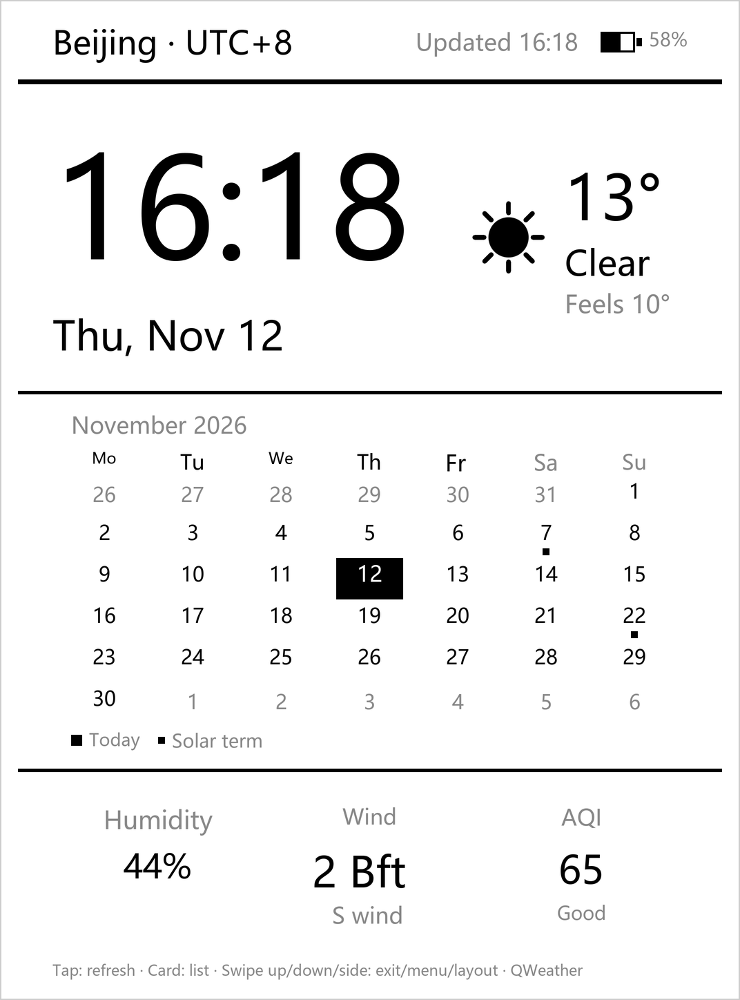
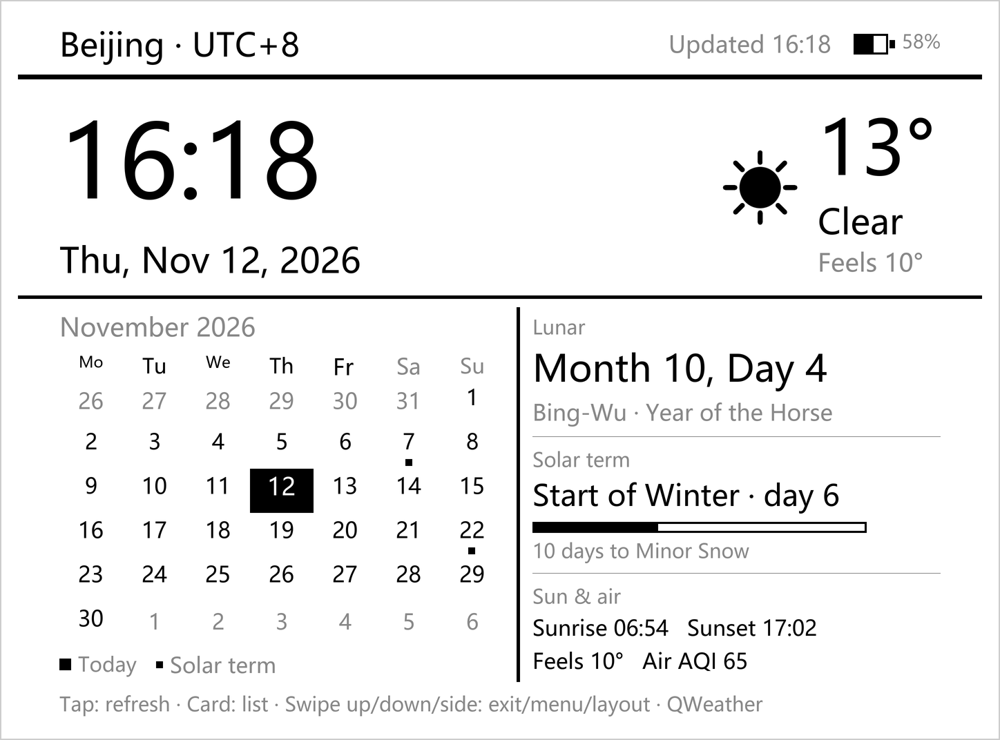
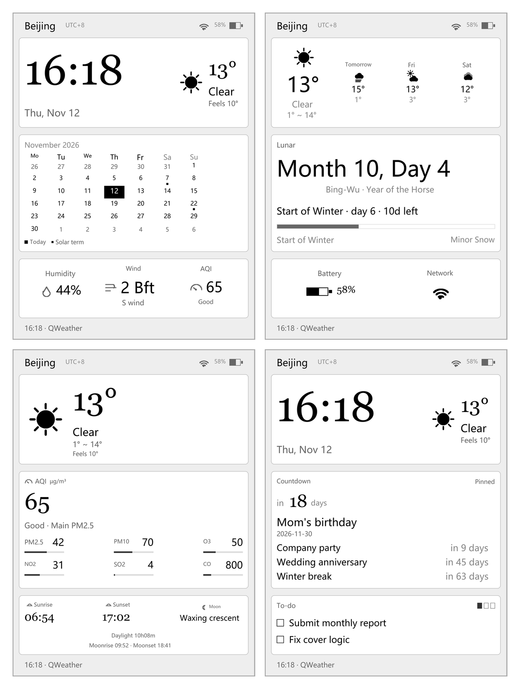

# Kindle Dashboard

[中文](README.md) · **English**

Turn the picture your Kindle keeps while asleep — a book cover, or a plain "Sleep" notice — into a
quiet board: time, Chinese lunar calendar and solar term, weather, the book you are reading, and
the few dates you are counting down to.

It is a **screensaver plugin for KOReader**, not another app. While you read it is still your
reader; put the book down and the screen becomes the board; touch it and you are back on the page.

## What it looks like

 

Rendered at exact device pixel size with demo data — these are not photos. The real panel is
300 ppi e-ink, closer to print.

The same machine can be arranged in many ways; switch from the menu at any time:

Left to right, top to bottom: clock and calendar · today and lunar · air and sun/moon ·
countdown and to-do.

## What it can show

Portrait and landscape are both three boxes (top / middle / bottom), each taking one item from a
list:

| Useful ones | What they show |
|---|---|
| Clock and weather | Big clock, with temperature, condition and feels-like on the right |
| Lunar and solar term | Month 10 Day 4 · Year of the Horse · day 6 of Start of Winter · 10 days to Minor Snow |
| Now reading | Cover, title, author, progress — it remembers where you stopped |
| Countdown | The pinned date as a big "18 days to go", plus three more below |
| To-do | Today's list; finished items get a tick and turn grey |
| Weather set | Big weather, today + 3 days, 7-day forecast, air quality detail, sun and moon |
| Status set | Humidity / wind / AQI row, battery and WiFi, month calendar |

Fifteen in total (grouped above) — fill the boxes however you like. Five portrait presets and five
landscape ones, or build your own.

34 cities (municipalities, provincial capitals, Hong Kong / Macao / Taiwan) and 10 time zones.
Chinese and English, switchable in the menu.

## Installing

Requires a jailbroken Kindle with KOReader already installed (those two steps are outside this
project).

1. Connect the Kindle by USB and open its storage.
2. Copy the whole `dashboard.koplugin` folder into `koreader/plugins/`
   (the folder name must end in `.koplugin`, otherwise it is skipped).
3. Eject safely, then **fully quit and reopen** KOReader — replaced Lua files are not reloaded
   while it is running.
4. Menu → Settings → Screen → Screensaver → Dashboard → choose city and time zone → "Open dashboard".

`dist/dashboard.koplugin.zip` is the same content; unzipping it into `plugins/` works too.

## Using it

| Gesture | What happens |
|---|---|
| Tap | Refresh weather and air quality |
| Tap the countdown / to-do card | Opens the list (re-pin, tick off, go add); tapping elsewhere still refreshes |
| Swipe up | Leave the board, back to reading |
| Swipe down from the top edge | The board's own menu (city, time zone, layout, weather service, relayout, help) |
| Swipe left or right | Portrait ↔ landscape (Kindle has no accelerometer, so this is manual) |

A small hint line stays at the bottom. A tap wakes the screen while it is asleep, and refreshes
while it is awake.

The board is full-screen and covers KOReader's own menu, so the swipe-down menu is the board's;
when the board is closed you can find the same settings at Settings → Screen → Screensaver →
Dashboard.

## Adding a date or a to-do

Menu → "Countdowns / To-dos" → Add, in **two steps**:

1. Type the name (e.g. `Mom's birthday`);
2. Then pick the date: year, month and day are three columns you scroll, defaulting to today.
   No keyboard for the date part.

Kindle has no usable Chinese IME, so dates are always picked and names should be short. If the
name happens to contain a date (`Christmas 2026-12-25`), it is split out and used as the default
for step 2.

The first countdown you add is pinned automatically; only one can be pinned. Finished to-dos are
cleared after 30 days.

## Weather: works without any API key

By default it uses Open-Meteo, which needs no account: temperature, condition, humidity, wind,
sunrise and sunset are all fine. Only air quality is estimated from PM2.5/PM10 concentrations
(the footer says "fallback").

For the official Chinese AQI and more local detail, get a key from QWeather
(<https://console.qweather.com>), then on the device: menu → "Weather service" → fill API Host and
API Key → "Test connection". **No USB or file editing needed**; settings live in KOReader, so a
key can be changed at any time. The free tier allows 50,000 calls a month; this plugin uses about
48 refreshes a day across three endpoints — roughly 4,300 a month.

## Why it feels "always on"

Because it is the screensaver. Put the book down, let it sleep, or press the power button, and the
screen stays on the board instead of jumping back to a cover. Menu → "Show dashboard when asleep
(screensaver)" turns this off.

One thing to know: e-ink stops its CPU while asleep, so the picture is static — **the clock shows
the time it fell asleep**. Touch to wake and it corrects itself immediately. Keeping minutes
ticking means staying awake on USB power, which is not recommended: a lithium battery held at full
charge for months can swell.

### Power

When it stays on, the power goes mostly into how often the screen refreshes. Defaults: the clock
updates every **5 minutes**, weather every **1 hour**, and the whole screen flashes once an hour to
clear ghosting.

All of it is adjustable under Menu → "Power saving". Push the clock to 10 or 30 minutes and the
number of screen updates drops proportionally; pick "Only on touch" and it stops moving on its
own — it corrects itself when you tap, and costs almost nothing.

Below 10% battery it throttles by itself (clock drops to a 30-minute step, weather and full
refresh stop) until you plug in. That threshold can be turned off.

## Troubleshooting

| Symptom | Check first |
|---|---|
| No "Dashboard" entry in the menu | Folder name ends in `.koplugin`, and it sits in `koreader/plugins/` |
| Black or blank screen | `koreader/crash.log` — usually a missing icon path |
| Text but no weather icons | Did `icons/` get copied with the folder? |
| Temperature stuck at `--°` | Menu → "Weather service → Test connection"; `401` usually means Host and Key do not match |
| Footer says "Open-Meteo (fallback)" | No key configured (normal), or the QWeather path failed |
| Still shows cover / Sleep after sleeping | Make sure "Show dashboard when asleep" is ticked |
| Sluggish for a few seconds after waking | It is fetching weather synchronously; this version adds a 25-second grace period |
| Clock stuck at the sleep time | Waking rebuilds the layout; if it never moves, check `crash.log` |
| Cannot swipe up to exit | Confirm you are on a current version; a `registerTouchZones` error in the log means KOReader is too old |
| Layout unchanged after rotating | Pick it manually in menu → "Layout" |

More, including exact log strings: [DEVELOPMENT.md](DEVELOPMENT.md) (Chinese).

## Known limits

- Minutes only: a seconds hand on e-ink leaves permanent ghosting.
- Long names are truncated with an ellipsis, not wrapped (single-line widget).
- Weather requests are synchronous: offline, a refresh can stall for up to 20 seconds.
- With the screensaver hook active, KOReader's native slide-to-unlock no longer appears — wake by
  touching the screen or pressing the power button.
- Cover images are cached in `settings/dashboard_covers/` (latest 6 only); old ones are not
  deleted immediately when you switch books.

## Uninstalling

Delete the `koreader/plugins/dashboard.koplugin` folder. The plugin writes no startup entries,
does not touch the Kindle framework, and modifies no system files.

## Supporting this project

If you find this project helpful, you are welcome to voluntarily tip the developer. Tipping is
entirely voluntary: it comes with no extra services and no guarantee of priority maintenance. The
project stays permanently open source and free.

---

To read or modify the code, check layout metrics and algorithms, or reproduce the verification:
see [DEVELOPMENT.md](DEVELOPMENT.md) (Chinese).
