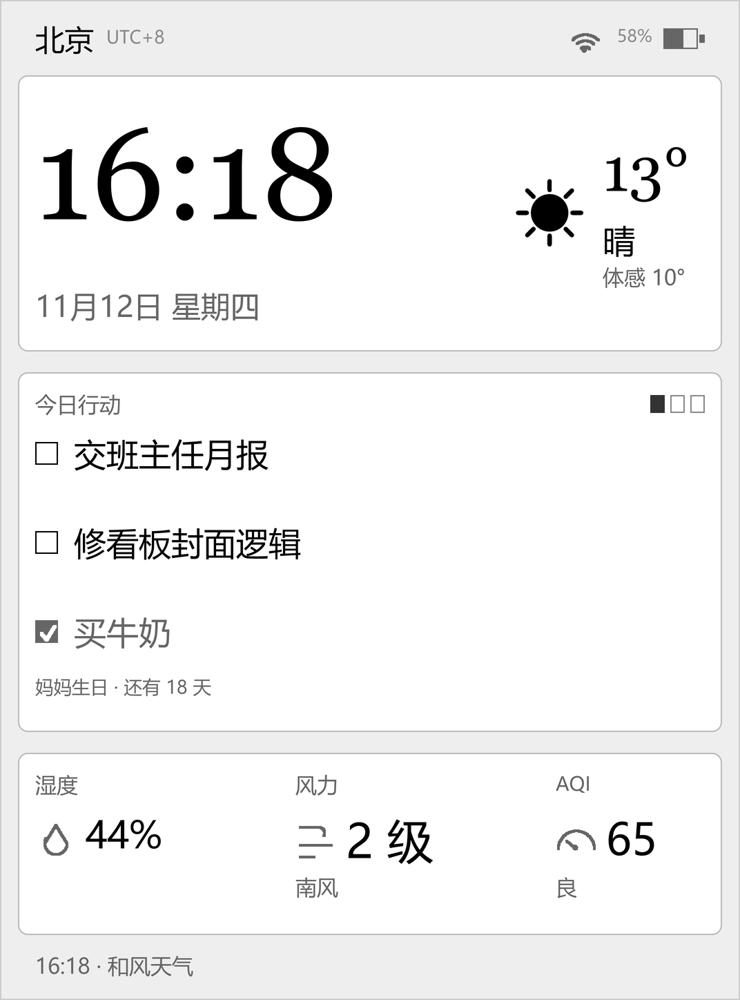
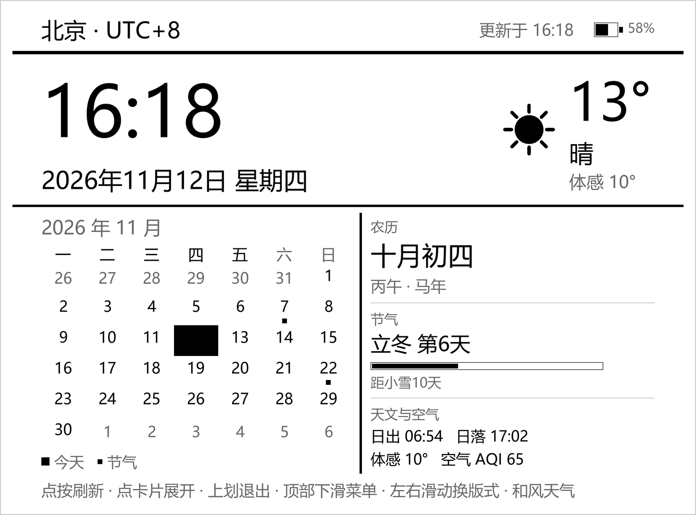
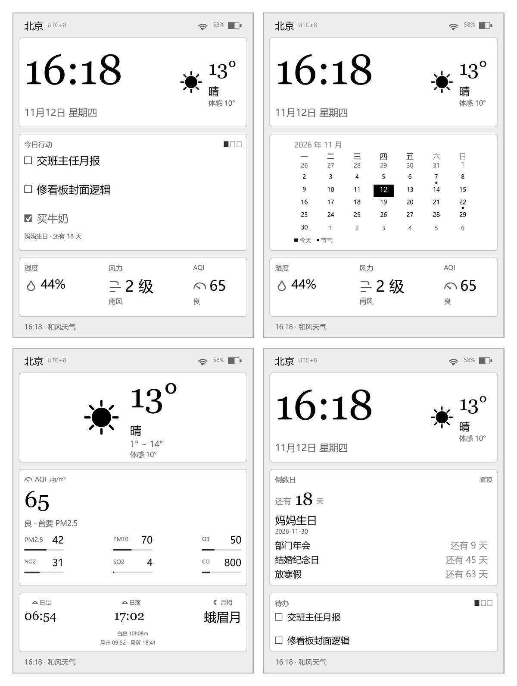

# Kindle 桌面看板

**中文** · [English](README.en.md)

把 Kindle 休眠后那张「书封 / Sleep」的画面，换成一块安静的看板：时间、农历与节气、天气、
你正在读的那本书、还有几个数着日子的日子。

它是 KOReader 的**屏保插件**，不是另装一个 App。读书时它还是阅读器；把书放下，屏幕就成了看板；
再碰一下，回到刚才那一页。

## 长什么样

 

示意图按设备像素渲染，真机是 300 ppi 电子墨水屏，观感更接近印刷品。

同一台机器可以排成很多种样子，菜单里随时换：

从左到右、从上到下：时钟与农历 · 时钟与月历 · 空气与日月 · 倒数日与待办。

## 能显示什么

竖屏横屏都是三个盒子（上、中、下），每个盒子从一个清单里挑一样放进去：

| 你会用到的 | 说明 |
|---|---|
| 时钟与天气 | 大时钟，右边温度、天况、体感 |
| 农历与节气 | 十月初四 · 丙午年 · 立冬第 6 天 · 距小雪 10 天 |
| 在读的书 | 封面、书名、作者、进度；合上书也记得你读到哪儿 |
| 倒数日 | 置顶那个显示成大字「还有 18 天」，下面再列三条 |
| 待办 | 今天要做的事，做完打勾变灰 |
| 天气类 | 纯天气、今日+三日、一周预报、空气明细、日月（日出日落与月相） |
| 状态类 | 湿度 / 风力 / 空气质量三格、电量与 WiFi、整月月历 |

一共 15 样（上表按类归并），按自己的需要往里放。竖屏、横屏各五套预设，也可以自己重新拼。

支持 34 个城市（直辖市、省会与港澳台）和 10 个时区；中英双语，菜单里切。

## 装到 Kindle 上

前提：设备已经越狱，并装好了 KOReader（这两步不在本项目范围内）。

1. USB 连电脑，打开 Kindle 的存储盘。
2. 把 `dashboard.koplugin` **整个目录**拷到 `koreader/plugins/` 下
   （目录名必须以 `.koplugin` 结尾，否则会被跳过）。
3. 安全弹出，在设备上**完全退出并重新打开** KOReader——换掉文件后必须重启才会加载新版。
4. 菜单 → 设置 → 屏幕 → 屏保 → 桌面看板 → 选「选择城市」「选择时区」→ 点「打开看板」。

`dist/dashboard.koplugin.zip` 是同样内容的压缩包，解压到 `plugins/` 也一样。

## 怎么用

| 操作 | 效果 |
|---|---|
| 碰一下屏幕 | 刷新天气与空气质量 |
| 碰「倒数日 / 待办」卡片 | 展开列表（换置顶、打勾、去添加）；碰别处还是刷新 |
| 上划 | 退出看板，回到阅读 |
| 屏幕上缘下滑 | 看板自己的菜单（城市、时区、版式、天气服务、重新布局、使用说明） |
| 左右滑 | 竖屏 ↔ 横屏（Kindle 没有重力感应，得手动换） |

底部常驻一行小字提示这些操作。休眠时碰一下屏幕是唤醒，醒着时碰一下是刷新。

看板是全屏的，KOReader 主菜单被它盖住，所以下滑弹出的是看板的菜单；看板没开时从阅读界面
下拉，也能在「设置 → 屏幕 → 屏保 → 桌面看板」里找到同一份设置。

## 加一个日子，或者一条待办

菜单 →「倒数日 / 待办事项」→ 添加，**两步**：

1. 先写名字（例：`妈妈生日`）；
2. 再点日期：年、月、日三列各自上下翻，默认就是今天，全程不弹键盘。

Kindle 上没有好用的中文输入法，所以日期一律点选，名字能短则短。名称里顺手带了日期
（`圣诞节 2026-12-25`）会自动拆出来，名字只留「圣诞节」。

第一条倒数日会自动置顶，置顶是单选。已完成的待办 30 天后自动清掉。

## 天气：不填凭据也能用

默认走 Open-Meteo，不需要任何账号：温度、天况、湿度、风力、日出日落都正常，
只有空气质量是按 PM2.5/PM10 浓度估算的（页脚会标「降级」）。

想要国标 AQI 和更贴本地实况的数据，就去和风天气（<https://console.qweather.com>）申请，
然后在设备上：菜单 →「天气服务」→ 填 API Host 与 API Key → 「测试连接」。
**不用插 USB 改文件**，设置存在 KOReader 里，换 key 随时改。免费额度每月 5 万次，
本插件一天约 48 次刷新、三个接口，折合一个月四千多次，用不完。

## 它为什么像「一直开着」

因为它就是屏保。放下书、空闲休眠，或者按一下电源键，屏幕留在看板上，不会跳回书封。
菜单里「休眠时显示看板（屏保）」可以关掉这个行为。

有一点得知道：电子墨水屏休眠时 CPU 停了，画面是静止的——**看板上的时间是它入睡那一刻的时间**。
碰一下唤醒，它会先把自己校正到此刻。想让分钟一直跳，只能插着电不休眠，不太建议，
锂电池长期满电容易鼓包。

## 遇到问题

| 现象 | 先看这里 |
|---|---|
| 菜单里找不到「桌面看板」 | 目录名是不是 `.koplugin` 结尾、是否放在 `koreader/plugins/` |
| 打开后黑屏 / 白屏 | `koreader/crash.log`，多是图标没拷过去 |
| 只有文字没有天气图标 | `icons/` 是否跟目录一起拷了 |
| 温度一直 `--°` | 菜单「天气服务 → 测试连接」，`401` 多为 Host 与 Key 不匹配 |
| 页脚写着「Open-Meteo（降级）」 | 没填凭据（正常），或者和风那一路失败了 |
| 休眠后还是书封 / Sleep | 确认「休眠时显示看板」是勾上的 |
| 唤醒后卡几秒 | 正在同步拉天气，这一版已加 25 秒宽限期 |
| 时钟停在睡前那一刻 | 唤醒会重建版面；若一直不动，看 `crash.log` |
| 上划退不出去 | 确认装的是新版；日志里若有 `registerTouchZones` 报错说明 KOReader 太旧 |
| 旋转后版式没变 | 菜单「版式」手动选 |

更多排查（含具体日志字样）见 [DEVELOPMENT.md](DEVELOPMENT.md)。

## 已知限制

- 只走到分钟：电子墨水屏做秒针会一直留残影。
- 长名字不折行，超了截成省略号（单行控件）。
- 天气请求是同步的：没网时点刷新可能卡上 20 秒。
- 接管屏保后，KOReader 原生的滑动解锁不再出现，靠碰屏幕或电源键唤醒。
- 在读卡的封面会缓存在 `settings/dashboard_covers/`，只留最近 6 个，换书后旧图不会立刻消失。

## 卸载

删掉 `koreader/plugins/dashboard.koplugin` 整个目录即可。插件不写启动项、不动 Kindle 框架、
不改任何系统文件。

## 支持这个项目

看板是业余时间写的，全程免费、无广告、不收集任何数据。如果它替你省了事，
可以扫码请我喝杯奶茶——**不打赏也照常更新，功能对所有人生效**。

---

想改代码、看版式尺寸与算法实现、跑验证：见 [DEVELOPMENT.md](DEVELOPMENT.md)。
