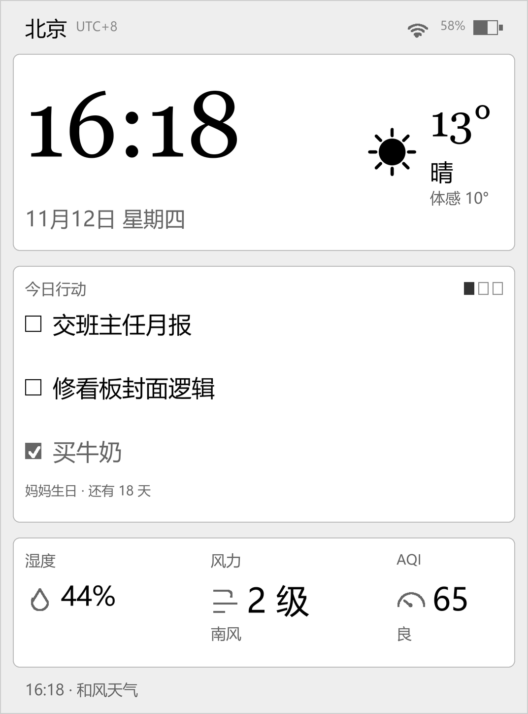
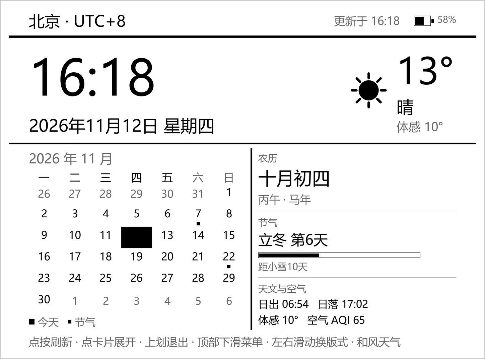
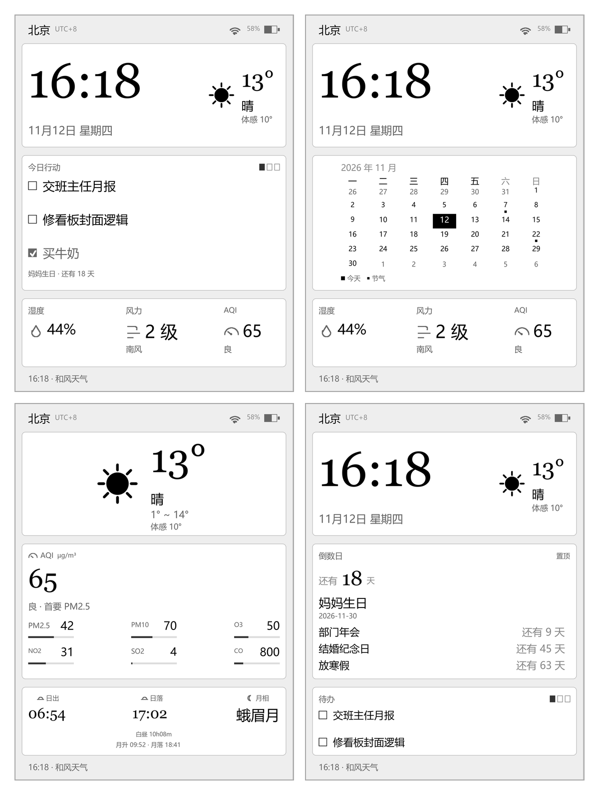

# 🕰️ Kindle 桌面看板 · 把休眠后那块墨水屏，变成一页安静的看板

[中文](README.md) · [English](README.en.md)

**时间 · 农历与节气 · 天气 · 在读的书 · 倒数日 · 待办 —— 把书放下，它们就亮在屏幕上。**

> Kindle 休眠后本来只显示一张书封，或一句 Sleep。换掉它，那块 300 ppi 的墨水屏就不再闲置。

<p align="center">
  
  
  
  
  
</p>

<p align="center">
  <a href="https://github.com/winrich/dashboard.koplugin" target="_blank">
    
  </a>
  <a href="https://github.com/winrich/dashboard.koplugin/commits/master" target="_blank">
    
  </a>
  
</p>

<table align="center">
  <tr>
    <td align="center"><b>🧩 16 种组件</b><br/><sub>上中下三格随意拼</sub></td>
    <td align="center"><b>🌍 81 城 · 43 时区</b><br/><sub>国内 34 · 海外 47</sub></td>
    <td align="center"><b>⏱️ 5 分钟</b><br/><sub>时钟默认跳一次</sub></td>
    <td align="center"><b>⚡ 0.45 秒</b><br/><sub>一次整屏刷完，不反白</sub></td>
  </tr>
</table>

> ⭐ **如果这台 Kindle 因此少落了几层灰，请给个 Star。**

---

## 🤔 你的 Kindle，休眠时在做什么

书放下，屏幕暗下去，然后它就这么躺着——大部分时间，那块屏是闲置的。

- 😴 睡前想看一眼明天会不会下雨，得先点亮、退出阅读、再找应用
- 😴 原生屏保就是几张书封轮着来，看久了等于没看
- 😴 想在桌上摆个时间与温度，就得再买一块墨水屏时钟，多一块屏、多一根线
- 😴 惦记着的那几个日子（谁生日、还有几天放假），没有任何地方替你数着
- 😴 想让它一直亮着吧，又担心一晚上把电耗光

**这个插件把休眠画面接管了**：放下书，屏幕变成看板；碰一下，回到刚才那一页。不装第二个应用，不动 Kindle 系统文件，删掉目录就干净了。

---

## 🆚 和另外几种做法比

| 做法 | 你得到什么 | 代价 |
|---|---|---|
| Kindle 原生屏保 | 一张书封，或一句 Sleep | 屏幕大部分时间是闲置的 |
| 手机上的天气 App | 天气与日历 | 得点亮手机，翻过锁屏和通知 |
| 桌上另买一块墨水屏时钟 | 时间和温度 | 多一块屏、多一根线、多一份钱 |
| **本插件** | 时间、农历节气、天气、在读的书、倒数日、待办，全在手上这台 Kindle 上 | 装一次，之后放下书就在 |

还有一点是别的做法给不了的：**它就是阅读器本身**。看的书、读到的页码、封面，都是它自己知道的，不需要你手输任何东西。

---

## 🧠 三十秒看懂


```text
看板 = 时间 + 农历节气 + 天气 + 在读的书 + 倒数日 + 待办
```

这些东西分装在**上、中、下三个盒子**里，每格从一个清单里挑一样放进去；竖屏和横屏各记一套，在菜单「外观」里换。

---

## 🖼️ 长什么样

<p align="center">
  
  &nbsp;&nbsp;&nbsp;
  
</p>

<p align="center"><sub>按设备像素渲染的示意图，真机是 300 ppi 电子墨水屏，观感更接近印刷品。这里是默认的「浅灰卡片风」，换成「报纸黑白风」见下一节</sub></p>

同一台机器可以排成很多种样子：

<p align="center"></p>

<p align="center"><sub>从左到右、从上到下：时钟与农历 · 时钟与月历 · 空气与日月 · 倒数日与待办</sub></p>

---

## 🎨 刷新与配色

电子墨水屏刷一次，花的时间**跟刷多大面积无关**。面板要把整块从上一帧扫到下一帧，扫 4 行和扫满屏，动作数一样多。真机实测：一次提交固定约 **0.45 秒**，跟 KOReader 翻一页同一个量级。

所以这一版不做「自左向右扫过去」的水波纹——那得一条一条反复提交，N 条就是 N × 0.45 秒，四百条要三分多钟。现在只有一次：**整屏推完，不反白**。屏幕不会先黑再白，只是轻轻按一下。

剩下那点闪，来自画面里的中间灰。灰阶要精确停在某个电位，波形得多帧调制、还会过冲，整片灰底一起重排，看上去就是整块暗一下。于是给了两套墨：

| 配色 | 画面 | 刷新时 |
|---|---|---|
| **浅灰卡片风**（默认） | 0xEE 灰纸底 + 白卡，层次柔和 | 整块轻微暗一下，已经很轻 |
| **报纸黑白风** | 纯白底 + 纯黑线字，全屏只有两阶 | 大片白底几乎不动，只剩黑字在变，最安静 |

菜单「外观 → 界面配色」里切，立即生效并重绘一次。受不了任何闪动就用报纸黑白风，代价是画面硬朗些、少一层柔和。

反过来不行：**不能做成黑底白字**。黑↔白是位移最大的一跳，翻过来最刺眼。

---

## 🧩 三个盒子，十六样东西

竖屏横屏都是三个盒子（上、中、下），每个盒子从一个清单里挑一样放进去：

| 你会用到的 | 说明 |
|---|---|
| 时钟与天气 | 大时钟，右边温度、天况、体感 |
| 大字时钟 | 只要时间，字号放到最大 |
| 农历与节气 | 十月初四 · 丙午年 · 立冬第 6 天 · 距小雪 10 天 |
| 在读的书 | 封面、书名、作者、进度；合上书也记得你读到哪儿 |
| 今日行动 | 倒数日与待办并成一张卡，一眼看完今天 |
| 倒数日 | 置顶那个显示成大字「还有 18 天」，下面再列三条 |
| 待办 | 今天要做的事，做完打勾变灰 |
| 天气类 | 纯天气、今日+三日、一周预报、空气明细、日月（日出日落与月相） |
| 状态类 | 湿度 / 风力 / 空气质量三格、电量与 WiFi、整月月历 |
| 侧栏三合一 | 横屏最右一栏竖排：农历、节气进度、日出日落与空气 |

一共 16 样（上表按类归并），按自己的需要往里放。竖屏和横屏各存一套，随时能换，也能一键恢复默认。

能画成图形的都画了：湿度是水滴、风力是风线、空气质量是刻度盘、WiFi 是三段弧（没连上加斜杠）、
待办进度是几格方块、空气六项各带一条「离国标限值还有多远」的比例条。
一屏扫过去就够，不必逐字读。

支持 81 个城市（国内 34：直辖市、省会与首府、港澳台；海外 47）与 43 个时区；中英双语，菜单里切。

---

## 🚀 装到 Kindle 上

前提：设备已经越狱，并装好了 KOReader（这两步不在本项目范围内）。

实测环境：**Kindle Paperwhite 3（KPW3，1072×1448，300 ppi）+ KOReader v2026.07.1**。其他机型没有逐台验证过；版面按屏幕尺寸自适应（`S = min(宽, 高) / 600`），尺寸差异由这条公式吸收。KOReader 版本过旧时 `crash.log` 里会出现 `registerTouchZones` 一类报错，先升级 KOReader 再试。

1. USB 连电脑，打开 Kindle 的存储盘。
2. 把 `dashboard.koplugin` **整个目录**拷到 `koreader/plugins/` 下
   （目录名必须以 `.koplugin` 结尾，否则会被跳过）。
3. 安全弹出，在设备上**完全退出并重新打开** KOReader——换掉文件后必须重启才会加载新版。
4. 菜单 → 设置 → 屏幕 → 屏保 → 桌面看板 → 点「打开看板」。
   城市与时区会先按设备的系统时区自动猜一个，不对再进「地点与天气 → 选择城市」改。

不想装 git 的话：在仓库页面点 **Code → Download ZIP**，解压后同样把 `dashboard.koplugin` 整个目录拷进 `koreader/plugins/`。等版本发布挂到 [Releases](https://github.com/winrich/dashboard.koplugin/releases) 之后，那里会直接给打好包的 `dashboard.koplugin.zip`，解压即用。

---

## 👆 怎么用

| 操作 | 效果 |
|---|---|
| 碰一下屏幕 | 刷新天气与空气质量 |
| 碰「倒数日 / 待办」卡片 | 展开列表（换置顶、打勾、去添加）；碰别处还是刷新 |
| 上划 | 退出看板，回到阅读 |
| 屏幕上缘下滑 | 看板自己的菜单（外观、地点与天气、内容、显示与省电、语言、使用说明） |
| 左右滑 | 竖屏 ↔ 横屏（Kindle 没有重力感应，得手动换） |

底部常驻一行小字提示这些操作。休眠时碰一下屏幕是唤醒，醒着时碰一下是刷新。

看板是全屏的，KOReader 主菜单被它盖住，所以下滑弹出的是看板的菜单；看板没开时从阅读界面下拉，也能在「设置 → 屏幕 → 屏保 → 桌面看板」里找到同一份设置。

### 菜单长什么样

顶层就六组，竖屏横屏都是一页放得下，不用翻页：

| 组 | 里面有什么 |
|---|---|
| 外观 | 竖屏 · 横屏（向右转 90°）· 横屏（向左转 90°）· 界面配色▸ · 竖屏布局▸ · 横屏布局▸ · 复制竖屏布局到横屏 · 恢复默认布局 |
| 地点与天气 | 选择城市▸ · 自动检测我的位置（按 IP） · 本机时区▸ · 天气服务▸ · 立即刷新天气 |
| 内容 | 倒数日▸ · 待办事项▸ |
| 显示与省电 | 休眠时显示看板（屏保）· 页脚手势提示 · 重新布局 · 省电设置▸ |
| 语言 / Language | 跟随 KOReader · 中文 · English |
| 使用说明 | 手势与路径速查，标题上带当前版本号 |

▸ 表示还有下一层。切横竖屏在「外观」第一屏；换配色是「外观 → 界面配色」；某个区放什么，是「外观 → 竖屏布局 / 横屏布局 → A/B/C 区 → 组件」。

---

## 📅 加一个日子，或者一条待办

菜单 →「内容 → 倒数日 / 待办事项」→ 添加，**两步**：

1. 先写名字（例：`妈妈生日`）；
2. 再点日期：年、月、日三列各自上下翻，默认就是今天，全程不弹键盘。

Kindle 上没有好用的中文输入法，所以日期一律点选，名字能短则短。名称里顺手带了日期（`圣诞节 2026-12-25`）会自动拆出来，名字只留「圣诞节」。

第一条倒数日会自动置顶，置顶是单选。已完成的待办 30 天后自动清掉。

---

## 🌍 不在国内也能用

城市覆盖国内 34 个（直辖市、省会与首府、港澳台）与海外 47 个主要城市。菜单里分两级：先选「国内城市」或「海外城市」，国内再分三组、海外再按亚洲 / 欧洲 / 北美洲 / 南美洲 / 大洋洲 / 非洲分六组。界面本身也是中英双语。

- **城市只管天气，不管时钟**。选「纽约」只把天气的来源地换成纽约，时钟仍按你所在的时区走——人在北京看纽约天气是正常需求，选城市把时钟也搬过去反而是错。
- **懒得找城市**：菜单 →「地点与天气 → 自动检测我的位置（按 IP）」。它联网查一次出口 IP 的大致位置，自动选最近的城市；查不到时弹出原因，已有设置一概不动。
- **夏令时自动处理**。伦敦、巴黎、纽约、洛杉矶、悉尼、奥克兰等按当地规则在夏季拨快一小时、冬季拨回；墨西哥与巴西已取消夏令时，按固定偏移处理；埃及与摩洛哥规则特殊，同样按固定偏移。
- **海外城市的天气走 Open-Meteo**。和风的空气质量接口只覆盖国内站点，海外坐标拿不到 AQI，所以海外城市直接走 Open-Meteo（免 Key），页脚照常标注来源。
- 顶栏时区统一显示 `UTC+8` / `UTC-5` 这类偏移，夏令时期间显示当前实际生效的那个。
- **「本机时区」是看板唯一的时区设置**：时钟、农历、月相、日出日落全按它显示。Kindle 大多不设置系统时区（`/etc/localtime` 指向的文件不存在），所以这一项只在这台设备读不到系统时区时才出现在「地点与天气」里。默认北京时间；设错了所有时间会整块偏移。点一次「自动检测我的位置」会连它一起设好。

首次启动、还没选过城市时：设备能报出系统时区就按它选一个（UTC+9 的设备选东京），报不出来（Kindle 常见）就用北京与东八区，不必一进来先改设置。

从 v3.1 及更早的版本升级时，原先在「选择时区」里挑过的时区会自动接成「本机时区」，不用重新设一次。

---

## 🌤️ 天气：不填凭据也能用

默认走 Open-Meteo，不需要任何账号：温度、天况、湿度、风力、日出日落都正常，只有空气质量是按 PM2.5/PM10 浓度估算的（页脚会标「降级」）。

想要国标 AQI 和更贴本地实况的数据，就去和风天气（<https://console.qweather.com>）申请，然后在设备上：菜单 →「地点与天气 → 天气服务」→ 填 API Host 与 API Key →「测试连接」。**不用插 USB 改文件**，设置存在 KOReader 里，换 key 随时改。

免费额度每月 5 万次，本插件一天约 48 次刷新、三个接口，折合一个月四千多次，用不完。

---

## 🔋 它为什么像「一直开着」

因为它就是屏保。放下书、空闲休眠，或者按一下电源键，屏幕留在看板上，不会跳回书封。菜单里「显示与省电 → 休眠时显示看板（屏保）」可以关掉这个行为。

有一点得知道：电子墨水屏休眠时 CPU 停了，画面是静止的——**看板上的时间是它入睡那一刻的时间**。碰一下唤醒，它会先把自己校正到此刻。想让分钟一直跳，只能插着电不休眠，不太建议，锂电池长期满电容易鼓包。

### 省电

常开的时候，电主要花在「多久刷一次屏」上。默认值：时钟 **5 分钟**跳一次，天气 **1 小时**拉一次，每 **180 分钟**清一次残影——合起来大约一天 288 次刷屏。

清残影这一步默认**不反白**：整屏推一遍轻波形，屏幕上几乎看不到闪，攒够 8 次才补一次真正的全刷。

菜单「显示与省电 → 省电设置」里都能改。把时钟调到 10 分钟或 30 分钟，屏幕驱动次数按比例减少；选「只在触摸时刷新」就完全不自己走——碰一下屏幕才校正时间，几乎不耗电；把清残影关掉画面更安静，代价是长时间显示同一版式会留下淡淡的影子。

电量掉到 10% 以下会自动降频（时钟降到 30 分钟一跳）并停掉自动拉天气和清残影，插上电或电量回升就恢复。这个阈值也能关掉。

---

## ❓ 遇到问题

| 现象 | 先看这里 |
|---|---|
| 菜单里找不到「桌面看板」 | 目录名是不是 `.koplugin` 结尾、是否放在 `koreader/plugins/` |
| 打开后黑屏 / 白屏 | `koreader/crash.log`，多是图标没拷过去 |
| 只有文字没有天气图标 | `icons/` 是否跟目录一起拷了 |
| 温度一直 `--°` | 菜单「地点与天气 → 天气服务 → 测试连接」，`401` 多为 Host 与 Key 不匹配 |
| 页脚写着「Open-Meteo（降级）」 | 没填凭据（正常），或者和风那一路失败了 |
| 休眠后还是书封 / Sleep | 确认「休眠时显示看板」是勾上的 |
| 唤醒后卡几秒 | 正在同步拉天气，这一版已加 25 秒宽限期 |
| 时钟停在睡前那一刻 | 唤醒会重建版面；若一直不动，看 `crash.log` |
| 上划退不出去 | 确认装的是新版；日志里若有 `registerTouchZones` 报错说明 KOReader 太旧 |
| 旋转后版式没变 | 菜单「外观」手动选 |
| 刷新时黑闪仍碍眼 | 菜单「外观 → 界面配色」换成「报纸黑白风」 |

更多排查（含具体日志字样）见 [DEVELOPMENT.md](DEVELOPMENT.md)。

---

## ⚠️ 已知限制

- 打开看板与转屏各有一次整屏刷新，约 0.5 秒，屏幕会整块轻微暗一下再恢复——这是电子墨水屏的物理下限，不是卡顿。
- 只走到分钟：电子墨水屏做秒针会一直留残影。
- 长名字不折行，超了截成省略号（单行控件）。
- 天气请求是同步的：没网时点刷新可能卡上 20 秒。
- 接管屏保后，KOReader 原生的滑动解锁不再出现，靠碰屏幕或电源键唤醒。
- 在读卡的封面会缓存在 `settings/dashboard_covers/`，只留最近 6 个，换书后旧图不会立刻消失。
- IP 定位只到城市级，可能选到邻市；选错了手动改一次即可，之后不再自动改。
- 顶栏左上偶尔会看到一行系统时间的小字（12 小时制、带「上午 / 下午」）。那是 Kindle 原生状态栏，它只写进帧缓冲、一般不真的上屏（真机照片核对过：屏上那里是空白）；万一上了屏，点一下看板触发重绘即可清掉。

---

## 🗑️ 卸载

删掉 `koreader/plugins/dashboard.koplugin` 整个目录即可。插件不写启动项、不动 Kindle 框架、不改任何系统文件。

---

## 💝 支持这个项目

如果你觉得本项目对你有帮助，可以自愿赞赏支持开发者。赞赏纯属自愿，不提供任何额外服务、不保证优先维护，项目永久开源免费。

<p align="center"></p>

---

<p align="center">
  ⭐ <b>如果这个项目对你有帮助，请给个 Star 支持一下。</b> ⭐
</p>

<p align="center"><sub>想改代码、看版式尺寸与算法实现、跑验证：见 <a href="DEVELOPMENT.md">DEVELOPMENT.md</a></sub></p>
